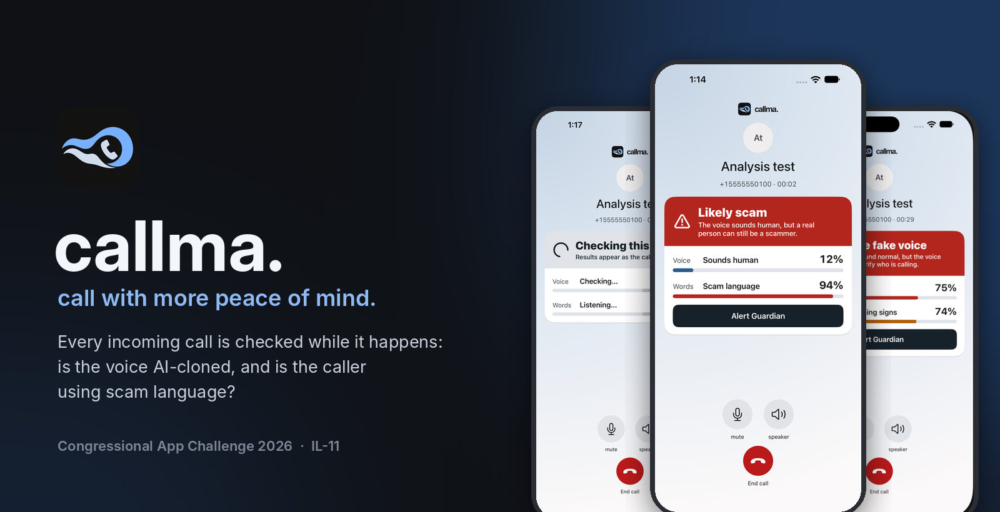
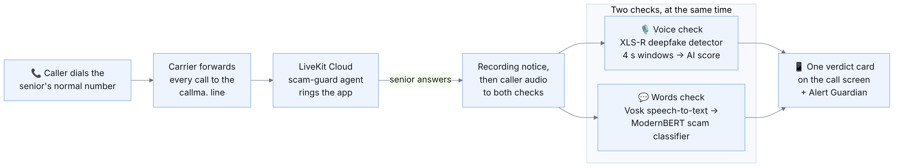
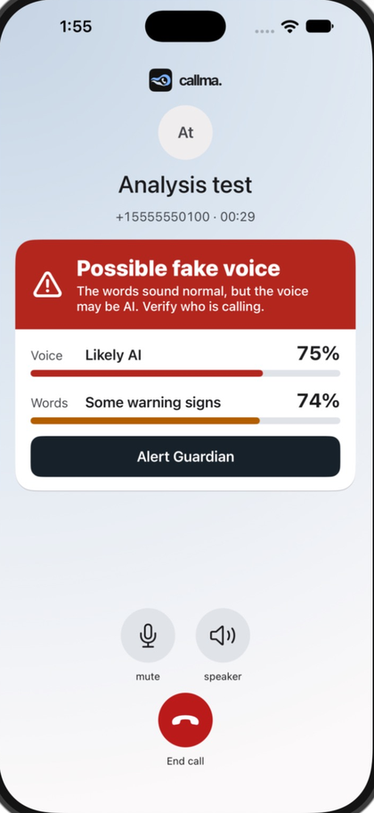
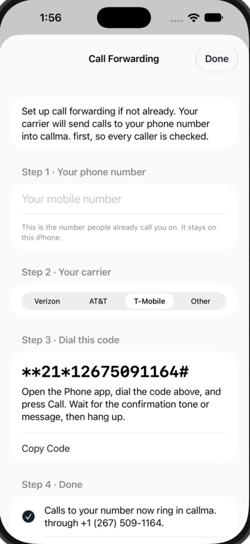

# callma.

**An iPhone calling app that protects older adults from AI voice-clone and phone scams, live, during the call.**


Scammers can now clone a family member's voice from a short recording and call asking for money. callma. listens to every incoming call while it happens and asks two questions:

- 🎙️ **Is this voice real, or AI-generated?** A fine-tuned speech model scores the caller's voice every 4 seconds.
- 💬 **Is the caller talking like a scammer?** The call is transcribed live and a fine-tuned language model looks for scam patterns such as requests for codes, gift cards, secrecy and urgency.

The answers appear on one simple card on the call screen, in plain words. If something looks wrong, one tap drafts a message to a trusted family member.

> 📘 **Full technical guide:** [docs/technical-guide/CALLMA_TECHNICAL_GUIDE.md](docs/technical-guide/CALLMA_TECHNICAL_GUIDE.md) covers setup, both models, training data, results, latency and scoring math.

---

## How it works



1. **Keep your number.** The senior turns on carrier call forwarding once (the app shows the exact code to dial), so every call to their normal number goes to the callma. line.
2. **The call is handled in the cloud.** LiveKit puts the call in its own room and our `scam-guard` agent rings the callma. app.
3. **The senior answers in callma.** A short notice says the call is being recorded, then the caller's audio, and only the caller's, goes to both checks at the same time.
4. **Results arrive within seconds.** The first voice verdict needs two 4-second windows of speech (about 10 seconds after pickup) and keeps updating for the whole call.

---

## The app

| Checking a call | Scam language, human voice | Possible fake voice |
|:---:|:---:|:---:|
|  |  |  |
| Both checks start right after pickup. | Words look like a scam, so the card warns that a real person can still be a scammer. | The voice looks AI-generated even though the words seem normal. |

| Alert a guardian | Call forwarding setup | Familiar phone layout |
|:---:|:---:|:---:|
|  |  |  |
| The senior picks a trusted person and reviews the message before sending. | Step-by-step codes for Verizon, AT&T and T-Mobile. | Favorites, Recents, Contacts, Keypad and Settings, with large text. |

---

## The two detectors

| | 🎙️ Voice check | 💬 Words check |
|---|---|---|
| **Model** | XLS-R 300M (first 12 layers) + attentive pooling head | GLiClass / ModernBERT-base, 151M parameters |
| **Started from** | `facebook/wav2vec2-xls-r-300m` | OpenJev "Verdict" (`heman10x/rlcd-modernbert-151m`) |
| **Our training** | Fine-tuned on MLAAD fakes and M-AILABS speech, then post-trained 7 times; the deployed **V8b** adds our own ElevenLabs clones, real phone calls and a phone-line simulator | Post-trained on 3,600 scam and normal call transcripts, then again on caller-only text (deployed **V2**) |
| **Input** | Caller audio, 16 kHz, non-overlapping 4 s windows | Live Vosk transcript, last 300 tokens |
| **Output** | Whole-call AI score 0–100 → *Sounds human* / *Not sure yet* / *Likely AI* | Scam score 0–100 → *No scam language* / *Some warning signs* / *Scam language* |
| **Runs on** | LiveKit Cloud container, PyTorch on CPU | Same container, ONNX Runtime |

### Results, before → after our training

| Voice model (held-out test set, V3 → V8b) | Before | After |
|---|---:|---:|
| ElevenLabs voices it never trained on, detected | 60.8% | **81.3%** |
| Real human speech wrongly flagged | 13.7% | **9.8%** |
| Unseen open-source TTS systems detected | 54.2% | **67.8%** |
| Benchmark clone calls ending "Likely AI" (of 42) | 23 | **29** |
| Benchmark human calls ending "Likely AI" (of 28) | 0 | **0** |

| Words model (accuracy, original → deployed V2) | Before | After |
|---|---:|---:|
| Cross-source test, ICFD (1,000 calls) | 44.7% | **88.1%** |
| External short-call test, Kaggle (800 calls) | 40.5% | **79.6%** |

Every voice-model release had to pass a **release gate written before training**: 19 checks against the previous model. V8b passed all 19; earlier versions that failed were never shipped. Details, caveats and the full tables are in the [technical guide](docs/technical-guide/CALLMA_TECHNICAL_GUIDE.md#5-pipeline-1-ai-voice-deepfake-detector).

---

## Safety features

- 🛡️ **Trusted guardians.** Save family members; on a high warning, *Alert Guardian* drafts a check-in message that the senior reviews and sends.
- ⏸️ **Pause Before Sharing.** Leave a very-high-risk call and come back, and callma. reminds you not to share codes, passwords or money.
- 🚫 **Block and report.** Block a number for yourself or report it for review. Blocked callers don't ring through.
- 🔤 **Built for older eyes.** Large type that scales, a call screen that never needs scrolling, plain-language advice, VoiceOver labels and Reduce Motion support.
- 🔒 **Honest by design.** Scores are labeled as experimental checks, never as proof of who is calling. No detector score blocks a call or sends a message on its own.

---

## Repository layout

| Folder | What's inside |
|---|---|
| [`ios/`](ios) | The callma. SwiftUI app (`Callma.xcodeproj`), unit and UI tests |
| [`backend/AI Deepfake Pipeline/`](backend/AI%20Deepfake%20Pipeline) | Voice model code, training notebooks and the LiveKit `scam-guard` agent (`LiveKit Setup/`) |
| [`backend/Transcript-Based Detector/`](backend/Transcript-Based%20Detector) | Transcript model service and Node connector |
| [`backend/jev-posttrain/`](backend/jev-posttrain) | Transcript-model training and evaluation scripts |
| [`deploy/livekit/`](deploy/livekit) | Cloud image, model server and deployment probe |
| [`model teseting/`](model%20teseting) | Benchmark harness and release-validation tools |
| [`docs/`](docs) | Technical guide, test reports and design notes |
| [`.github/workflows/`](.github/workflows) | CI: call pipeline, simulator tests, cloud deploy, tester access |

---

## Try it

### Test the full app on a Mac (no backend setup needed)

The models and speech recognition already run in LiveKit Cloud.

```sh
git clone https://github.com/shreymp/congressional-app-challenge-2026.git
cd congressional-app-challenge-2026
python3 scripts/tester_access.py install   # writes a limited 7-day app token; needs GitHub CLI access to this repo
open ios/Callma.xcodeproj
```

1. In Xcode 26, choose the **Callma** scheme and an iPhone simulator, then **Product → Run**. Allow microphone access.
2. From a separate phone, call **+1 267-509-1164**. Accept in the simulator. (Wait about 45-60 seconds the first time for the server to start.)
3. Speak from the calling phone for 45–60 seconds and watch both checks on the call screen.

Step-by-step details: [MACBOOK_TESTING.md](MACBOOK_TESTING.md).

### Use it with your own number (not recommended)

Turn on call forwarding of **all calls** to +1 267-509-1164 (for example `*72` on Verizon). The app's **Settings → Call Forwarding Instructions** shows the code for your carrier. Keep the app open: this build rings only while it is in the foreground.

### Run or deploy the backend

See [section 3 of the technical guide](docs/technical-guide/CALLMA_TECHNICAL_GUIDE.md#3-what-has-to-be-set-up-before-it-works) for LiveKit, GitHub Actions and model setup, and [`deploy/livekit/README.md`](deploy/livekit/README.md) for the cloud deployment.

---

## Limits we're honest about

- Neither check can prove who is calling. A human scammer passes the voice check, and a real relative can sound urgent.
- Phone-line audio is the hardest case for the voice model, and it has not yet been measured on fresh real calls from new speakers.
- The words model was trained mostly on synthetic call transcripts, in English only.
- The app rings only while it is open (no push notifications in this build).

The [full list](docs/technical-guide/CALLMA_TECHNICAL_GUIDE.md#13-known-limitations) is in the technical guide.

---

## Privacy and consent

Every answered call starts with *"This call is being recorded."* Only the caller's audio is analyzed. Transcripts are never logged. Caller-audio recording is **on in the current test deployment** to collect consented phone-line data; Illinois requires every party's consent, so only use it on calls where everyone has agreed.

## Credits

Built for the **2026 Congressional App Challenge (IL-11)**. Thanks to the open models and datasets this work builds on: [XLS-R](https://huggingface.co/facebook/wav2vec2-xls-r-300m), [OpenJev / Verdict](https://github.com/Heman10x-NGU/Verdict-open-jev), [GLiClass](https://huggingface.co/knowledgator/gliclass-modern-base-v2.0), [MLAAD](https://arxiv.org/abs/2401.09512), [LibriSpeech](https://www.openslr.org/12), [Vosk](https://alphacephei.com/vosk/) and [LiveKit](https://livekit.io). Several training datasets carry non-commercial licenses (for example MLAAD, CC BY-NC 4.0), so the trained models are for this student project, not commercial use.

Made by Shrey Patel<sup>1</sup>, Keshav Parikh<sup>2</sup>, and Azim Salomov<sup>3</sup>
Contact spatel7@imsa.edu for any questions.
