# callma. — Technical Guide

**AI voice-clone and phone-scam protection for older adults**
Congressional App Challenge 2026 · IL-11

| | |
|---|---|
| Document date | October 25, 2026 |
| Code described | `shreymp/congressional-app-challenge-2026`, `main` at `8efcee2` (merge of PR #28, Oct 25, 12:43 CT), plus uncommitted work in the local checkout where marked **[local, uncommitted]** |
| Deployed voice model | Deepfake detector **V8b** (`detector_state_v8b.pt`, SHA-256 `cc6a75ea…72f9703d5`) |
| Deployed transcript model | JEV call model **V2 (caller-only)** (`jev-call-v2-model.onnx`, SHA-256 `8f7bbb21…541c8a`) |

---

## Contents

1. [What callma. does](#1-what-callma-does)
2. [System architecture](#2-system-architecture)
3. [What has to be set up before it works](#3-what-has-to-be-set-up-before-it-works)
4. [The life of a call](#4-the-life-of-a-call)
5. [Pipeline 1: AI-voice (deepfake) detector](#5-pipeline-1-ai-voice-deepfake-detector)
6. [Pipeline 2: Transcript scam-language detector](#6-pipeline-2-transcript-scam-language-detector)
7. [Inference, scoring and thresholds in detail](#7-inference-scoring-and-thresholds-in-detail)
8. [Latency](#8-latency)
9. [What the user sees: the app](#9-what-the-user-sees-the-app)
10. [Safety features beyond detection](#10-safety-features-beyond-detection)
11. [Privacy, consent and security](#11-privacy-consent-and-security)
12. [Testing and verification](#12-testing-and-verification)
13. [Known limitations](#13-known-limitations)
14. [Reference: settings, files and endpoints](#14-reference-settings-files-and-endpoints)

---

## 1. What callma. does

callma. is an iPhone calling app that checks every incoming call for two warning signs while the call is happening:

1. **Is the caller's voice AI-generated?** A fine-tuned speech model scores the caller's audio in 4-second windows and keeps a running, whole-call verdict: *Sounds human*, *Not sure yet*, or *Likely AI*.
2. **Is the caller using scam language?** The caller's speech is transcribed live and a fine-tuned text classifier scores how strongly the conversation looks like a scam (requests for codes, money, gift cards, secrecy, urgency and so on).

Both results appear on one card on the call screen. When either check crosses its warning level, the app offers an **Alert Guardian** button that drafts a message to a trusted family member, and it gives plain advice ("Don't share money, codes, or passwords"). After the call, the user can block or report the number.

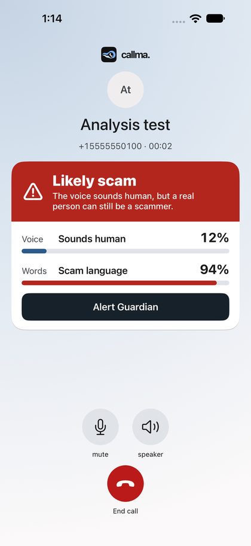

*The call screen when the caller's voice sounds human but the words look like a scam. Section 9 has every screen.*

The senior keeps their normal phone number. Their carrier forwards every call to the callma. phone line, the call is routed through the team's LiveKit backend where both detectors listen to the caller, and the senior answers in the callma. app.

> **What the scores are not.** Neither score proves who is calling, and neither is a calibrated probability on real phone calls. The voice score is a heuristic 0–100 "AI evidence" score; the transcript score is calibrated only on synthetic validation calls. The app's wording says this. Section 13 lists the limits.

---

## 2. System architecture

### 2.1 Components

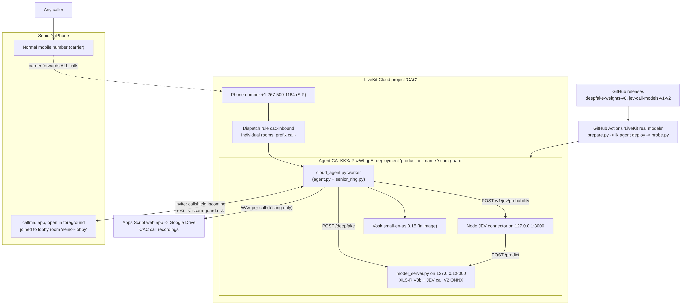

*Figure 1. Where each part runs. Everything inside the yellow LiveKit box runs in one hosted container.*

| Component | Where it runs | What it does | Key files |
|---|---|---|---|
| **Carrier call forwarding** | Senior's mobile carrier | Sends every call to the senior's number on to the callma. line | (set by dialing a carrier code; see 3.1) |
| **callma. phone line** | LiveKit Cloud telephony, project **CAC** | Number **+1 267-509-1164**, receives the forwarded SIP call | LiveKit dashboard |
| **Dispatch rule `cac-inbound`** | LiveKit Cloud | Puts each call in its own room (`call-…`) and dispatches the agent named `scam-guard` | `LiveKit Setup/dispatch-rule.json` |
| **`scam-guard` agent** | LiveKit Cloud agent `CA_KKXaPczWhqpE`, deployment `production` | Rings the app, plays the recording notice, feeds caller audio to both pipelines, publishes results | `deploy/livekit/cloud_agent.py`, `LiveKit Setup/agent.py`, `senior_ring.py`, `scoring.py`, `risk.py`, `transcript_pipeline.py` |
| **Model server** | Same container, `127.0.0.1:8000` | Loads the voice model (V8b) and the transcript model (JEV V2) once and serves both | `deploy/livekit/model_server.py`, `backend/AI Deepfake Pipeline/inference.py`, `backend/Transcript-Based Detector/model_service.py` |
| **JEV connector** | Same container, `127.0.0.1:3000` (Node 22) | Validates transcript requests and forwards them to the model server | `backend/Transcript-Based Detector/server.js` |
| **Vosk speech recognizer** | Same container (in the image) | Streaming English speech-to-text of the caller | `vosk-model-small-en-us-0.15` |
| **callma. iOS app** | Senior's iPhone (SwiftUI, LiveKit Swift SDK, CallKit) | Waits in the lobby room, rings with CallKit, joins the call room, shows results, guardian and blocking features | `ios/Callma/…` |
| **Safety service** (optional) | Any HTTPS host | Stores personal blocks, reports and reviewed shared blocks; the agent checks it before ringing | `LiveKit Setup/safety_service.py`, `safety_store.py` |
| **Recording upload** (testing) | Google Apps Script web app | Receives each call's caller-audio WAV in 60 s parts and saves it to Drive folder *CAC call recordings* | `LiveKit Setup/drive_upload.py` |
| **Deploy pipeline** | GitHub Actions *LiveKit real models* | Builds the image with checksum-pinned models from GitHub releases, deploys, then sends a test audio probe through the live agent | `.github/workflows/livekit-cloud.yml`, `deploy/livekit/prepare.py`, `probe.py` |

### 2.2 Why calls are routed through a server

iOS does not let a third-party app listen to ordinary cellular calls, and carriers cannot forward calls selectively by caller. The workable design is to forward **all** calls to a programmable phone line, handle the call in the cloud, and let the senior answer in the app. Earlier designs (Twilio-based, then a "verified callback" app with no live analysis) were dropped: Twilio's compliance profile required a government ID, and the callback design gave up live detection.

### 2.3 The two pipelines at a glance

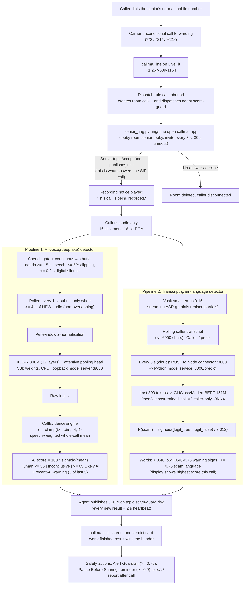

*Figure 2. End-to-end flow of one incoming call through both detection pipelines.*

| | Pipeline 1: Voice | Pipeline 2: Words |
|---|---|---|
| Question | Is the voice synthetic? | Is the caller saying scam things? |
| Input | Caller audio, 16 kHz mono, contiguous 4 s windows | Caller audio → Vosk transcript, last 300 tokens |
| Model | XLS-R 300M (first 12 of 24 layers) + attentive pooling head | GLiClass / ModernBERT-base (151M) decision model |
| Starting checkpoint | `facebook/wav2vec2-xls-r-300m` | OpenJev "Verdict" `heman10x/rlcd-modernbert-151m` |
| Our training | 1 fine-tune (V2) + post-training rounds (V3 → V8b) | 2 post-training passes (V1 → V2 caller-only) |
| Deployed version | V8b | Call V2 (caller-only) |
| Update rate | One new window per 4 s of audio (polled each 1 s) | One request every 5 s while the transcript changes |
| Output to app | Whole-call AI score 0–100 + verdict + recent-AI warning | Probability 0–1, shown as the highest score so far this call |
| Runtime | PyTorch on CPU (2 threads) in the cloud container | ONNX Runtime on CPU in the same container |

---

## 3. What has to be set up before it works

This is the full checklist. Items 3.1 and 3.6 are per senior; the rest is a one-time backend setup that already exists for the CAC project.

### 3.1 Carrier call forwarding (per senior, required)

The senior's carrier must forward **all** calls ("unconditional" forwarding) to the callma. line, **+1 267-509-1164**. iOS cannot turn on carrier forwarding for an app, so the senior (or a family member) dials a code once from the iPhone's Phone app.

| Carrier | Turn forwarding on | Turn it off |
|---|---|---|
| Verizon | `*72` + `2675091164` | `*73` |
| AT&T | `*21*` + `2675091164` + `#` | `#21#` |
| T-Mobile / other GSM | `**21*1` + `2675091164` + `#` | `##21#` |

These are the codes built into the app's **Call Forwarding** helper **[local, uncommitted]** (Settings → *Call Forwarding Instructions*), which also lets the senior enter their own number and copy the code. Codes can differ by plan; if one does not work, ask the carrier to "forward all calls" to +1 267-509-1164. Whether forwarding costs extra depends on the senior's plan, so check with the carrier.

Why it must be *all* calls: carriers cannot forward based on who is calling. A side effect is that the carrier's voicemail never answers, so unanswered calls are handled by callma. (see 4.3).

For testing without forwarding, call +1 267-509-1164 directly.

### 3.2 LiveKit Cloud (one time, already configured for project CAC)

Verified in the dashboard on Oct 16, 2026:

1. **Telephony → Phone numbers:** `+12675091164` is active.
2. **Telephony → Dispatch rules:** rule `cac-inbound`, *Individual* rooms, prefix `call-`, attached to that number, dispatching agent `scam-guard`:
   ```json
   {
     "name": "cac-inbound",
     "rule": { "dispatchRuleIndividual": { "roomPrefix": "call-" } },
     "roomConfig": { "agents": [{ "agentName": "scam-guard" }] }
   }
   ```
3. **Agents:** deployment `CA_KKXaPczWhqpE` (`production`, restart on failure). `livekit.toml` holds the project subdomain and agent ID.
4. **Agent secrets** (set with `lk agent update-secrets` or at deploy time; `.env` files are not copied into the image):

   | Secret | Value | Purpose |
   |---|---|---|
   | `DETECTOR` | `remote` | Agent uses the in-container model server |
   | `TRANSCRIPT_ENABLED` | `1` | Turns on Vosk + JEV |
   | `RECORD_CALLER_AUDIO` | `1` (testing) | Saves caller audio after the notice; set `0` to turn off |
   | `GDRIVE_UPLOAD_URL`, `GDRIVE_UPLOAD_TOKEN` | Apps Script `/exec` URL and shared token | Recording upload (required by the deploy workflow) |
   | `THRESHOLD_ELEVATED_LOGIT`, `THRESHOLD_HIGH_LOGIT` | `-0.28906250000000044`, `4.3203125` | **Recommended** call thresholds for V8b (see 7.4). Not set by the repository's deploy command; verify they are set |
   | `RING_TIMEOUT_SEC` (optional) | default `30` | How long the app rings |

### 3.3 GitHub (one time)

- **Release assets** (private): `deepfake-weights-v8` → `detector_state_v8b.pt` (659 MB) plus its reports; `jev-call-models-v1-v2` → ONNX model, tokenizer and calibration for V1 and V2. `prepare.py` pins every file by SHA-256.
- **Actions secrets:** `LIVEKIT_URL`, `LIVEKIT_API_KEY`, `LIVEKIT_API_SECRET` (project CAC), `GDRIVE_UPLOAD_URL`, `GDRIVE_UPLOAD_TOKEN`.
- **Deploy:** run the *LiveKit real models* workflow on `main` with `deploy=true`. It builds and exercises the real models, deploys to LiveKit, then runs `probe.py`, which sends a checked-in speech file through the live agent and requires both a real voice score and a fresh transcript probability (**BACKEND PROBE PASSED**). Use `probe_only=true` to re-test without redeploying.
- Manual equivalent:
  ```sh
  python3 deploy/livekit/prepare.py --output .cloud-context      # needs a read-only GH_TOKEN
  lk --project CAC agent deploy .cloud-context --id CA_KKXaPczWhqpE --deployment production \
    --secrets DETECTOR=remote --secrets TRANSCRIPT_ENABLED=1 --secrets RECORD_CALLER_AUDIO=1 \
    --secrets GDRIVE_UPLOAD_URL=... --secrets GDRIVE_UPLOAD_TOKEN=...
  python3 deploy/livekit/probe.py ios/ScamTranscriptTests/Fixtures/bank.wav
  ```

### 3.4 What the container image contains

Built by `deploy/livekit/Dockerfile` (Python 3.11 slim, Node 22, PyTorch 2.9.1 CPU):

- V8b voice weights + `detector_config.json` + pinned XLS-R architecture config (no Hugging Face download at call time; `HF_HUB_OFFLINE=1`).
- JEV V2 ONNX bundle (model, tokenizer, `calibration.json` with temperature 3.0118).
- Vosk `small-en-us-0.15` (SHA-256 pinned).
- The recording notice WAV, generated at build time with eSpeak NG + SoX. The build fails if it is missing, silent or invalid.
- `model_integrity.json`: startup refuses to run if the architecture, checkpoint or detector-config hash does not match.

Startup order (`cloud_agent.py`): start the model server, wait for deepfake warm-up and a real JEV inference, start the Node connector, load Vosk, then register the worker. If the model server crashes, the worker exits so LiveKit restarts it.

### 3.5 Google Drive recording upload (testing only)

`drive_upload.py` POSTs each call's caller audio, split into 60-second WAV parts, to a Google Apps Script web app (deployed "Execute as: Me") that saves them to *CAC call recordings*. Requests must carry the shared token. Only use this on calls where **everyone has agreed to be recorded** (Illinois requires all-party consent).

### 3.6 The iPhone app (per device)

1. Xcode 26, project `ios/Callma.xcodeproj`, scheme **Callma**.
2. Connection settings go in the git-ignored `ios/Configuration/Local.xcconfig`:
   - Testers: `python3 scripts/tester_access.py install` downloads a 7-day, room-scoped app token generated by the *Tester app access* workflow. No LiveKit key or secret reaches the Mac.
   - Owners: `python3 tools/mint_lobby_token.py` prints `CALLMA_LIVEKIT_HOST` and `CALLMA_LOBBY_TOKEN` (default 30 days).
3. Optional safety service: `CALLMA_SAFETY_BASE_URL` (HTTPS) and a per-user `CALLMA_SAFETY_TOKEN`.
4. Grant microphone access. Keep the app **open in the foreground**: this build has no push notifications (free Apple developer account, so no PushKit/APNs), so it rings only while open.
5. The app connects to lobby room `senior-lobby` as identity `senior`. Xcode's console shows *lobby connected; waiting for incoming calls*. Only one device can use that identity at a time.

### 3.7 Optional: outgoing calls through callma.

Implemented but not verified on a live trunk (`OUTBOUND_CALLING.md`): an outbound SIP trunk, `outbound_service.py` behind HTTPS (`CALLMA_OUTBOUND_TRUNK_ID`, `CALLMA_OUTBOUND_ALLOWED_NUMBERS`), and the gateway URL in the app's advanced connection settings. Without it, outgoing calls use the normal mobile service and are not analyzed.

### 3.8 Optional: safety service

`python safety_service.py --db /private/path/callma-safety.sqlite3` (default `127.0.0.1:8010`) with `CALLMA_SAFETY_DB`, `CALLMA_SAFETY_TOKENS_JSON` (≥32-character bearer token → user ID) and an admin token for reviewed shared blocks. Put it behind HTTPS. See section 10.3.

---

## 4. The life of a call

### 4.1 Ringing

1. A caller dials the senior's number. The carrier forwards it to +1 267-509-1164.
2. LiveKit creates room `call-<number>-<suffix>` and dispatches `scam-guard`. The caller hears ringing; **LiveKit has not answered yet**.
3. `senior_ring.py` checks the safety service (if configured). A blocked number is disconnected without ringing.
4. Otherwise it sends an invite on data topic `callshield.incoming` to the app in `senior-lobby`, and repeats it every 3 s until the app joins, the caller hangs up, or 30 s pass. The invite carries a per-call UUID, the room name, a 10-minute token for this room only, and the caller's number.
5. The app shows the native CallKit incoming-call screen and silently joins the call room (microphone off).

### 4.2 Answering, notice and analysis

6. When the senior taps **Accept**, the app publishes its microphone. **Publishing audio is what answers the SIP call**, so the caller's call timer starts only now.
7. The agent waits for that pickup, then plays the fixed clip **"This call is being recorded."** into the room (both sides hear it) and waits for playback to finish (15 s timeout). If the notice fails, analysis and recording stay off for that call, while ringing and hang-up handling keep working.
8. The agent subscribes to the **caller's audio only** (never the senior's) at 16 kHz mono and sends every frame to both pipelines (sections 5–7), plus to the recorder if enabled.
9. Results go to the app on data topic `scam-guard.risk` after every new voice score and in a heartbeat every 2 s.

### 4.3 Endings

| Event | What happens |
|---|---|
| Caller hangs up | Agent stops; app ends the CallKit call |
| Not answered in 30 s, or declined | After a 5 s grace period (or the end of the ring window), `no_answer_fallback()` runs once and the room is deleted, which disconnects the caller. Voicemail and family notification on no-answer are not implemented |
| Senior hangs up | If the app is not back within 5 s, the room is deleted and the caller disconnected (room deletion retried up to 3 times) |
| Senior taps "Stop checking this call" **[local, uncommitted]** | The app sets its participant attribute `callma.analysis = stopped`. The agent stops scoring and transcription, sends no more results, and discards the caller recording for that call |

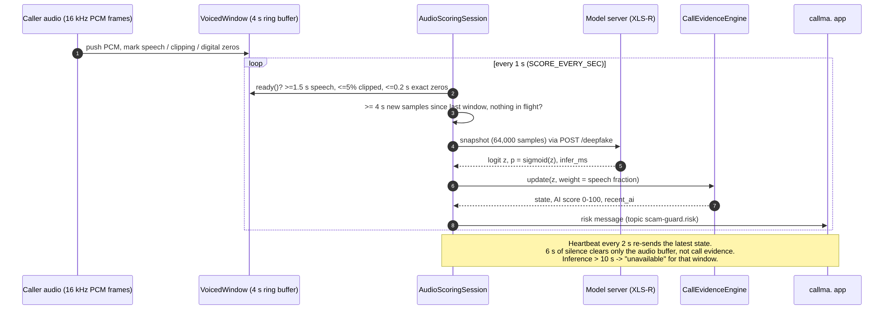

*Figure 3. One voice-scoring cycle inside the agent.*

---

## 5. Pipeline 1: AI-voice (deepfake) detector

### 5.1 Backend

The voice model runs inside the LiveKit Cloud agent container. The agent (`DETECTOR=remote`) sends each 4-second window as raw float32 PCM to `POST http://127.0.0.1:8000/deepfake` on the in-container model server, which runs PyTorch on CPU with 2 threads and returns the raw logit, the sigmoid and the inference time. One window is scored at a time (the server answers *busy* to a second concurrent request, and the agent never sends one).

For local development the same code can load the model directly (`DETECTOR=real`, Apple Silicon `mps`, CUDA or CPU) or use fake scores (`DETECTOR=stub`).

### 5.2 Architecture and original model

- **Original model:** [`facebook/wav2vec2-xls-r-300m`](https://huggingface.co/facebook/wav2vec2-xls-r-300m), Meta's self-supervised XLS-R speech model (300M parameters, 24 transformer layers), pretrained without labels on about 436,000 hours of speech in 128 languages. It was not trained for deepfake detection.
- **Our detector** (`inference.py`, `DeepfakeDetector`):
  - The **first 12 of the 24 transformer layers** (about 2× faster). The CNN feature encoder is frozen.
  - A learned softmax weighting over the 13 hidden-state outputs (CNN output + 12 layers).
  - LayerNorm → Linear 1024→256 → GELU.
  - **Attentive statistics pooling** (attention-weighted mean and standard deviation over time) → 512 values.
  - Head: Dropout 0.2 → Linear 512→128 → GELU → Dropout 0.2 → Linear 128→1. The output is one **logit**; `sigmoid(logit)` = "probability the audio is AI-generated" (uncalibrated).
  - 164.6M parameters in total (160.4M trainable during the first fine-tune).
- **Input:** exactly 4.0 s at 16 kHz (64,000 samples), z-normalized per window (subtract mean, divide by standard deviation), so loudness does not matter.

### 5.3 Training history

The model went through one fine-tune and seven post-training versions. Only versions that passed a release gate written before each run were deployed.

| Version | Date | Started from | What changed | Outcome |
|---|---|---|---|---|
| **V2** | Oct 10 | XLS-R 300M | First fine-tune on MLAAD fakes + M-AILABS real speech, phone-channel augmentation | Deployed first |
| **V3** | Oct 22–23 | V2 | Robustness post-training: LibriSpeech speakers, label-blind noise / silence-gap / codec / music / DTMF augmentation, float64 thresholds | Deployed, replaced V2 |
| V4 | Oct 23 | V3 | First ElevenLabs-targeted run with a self-correcting "Guardian" loop | The loop rolled back 4 times on a 32-window objective too small to measure progress, then stopped; nothing kept |
| V5 | Oct 23–24 | V3 | Added a public Mendeley ElevenLabs/Respeecher set | Failed gate: that set is Spanish, mostly voice-to-voice, and separable by channel alone (AUC 0.91), so the model learned the dataset, not ElevenLabs |
| V6 | Oct 24 | V3 | Diagnostics D0–D6 + fixes | Failed gate |
| V7 | Oct 24 | V3 | Team's own 12 English ElevenLabs voices, phone-call simulator, self-improving rounds | Passed 16 of 18 gate rows; not deployed |
| V8 | Oct 24 | V3 | Selection matched to the gate, +251 unseen LibriSpeech speakers, weight averaging | Superseded by V8b (same recipe, more data) |
| **V8b** | Oct 25 | V3 | V8 + 36 more ElevenLabs clips (new voices) + 9 real-call recordings | **Passed all 19 gate rows. Deployed** |

#### V2: first fine-tune

| Setting | Value |
|---|---|
| Fakes | English part of **MLAAD-tiny** plus up to 150 extra clips per TTS system from the full (gated) **MLAAD** dataset |
| Real speech | English **M-AILABS** audiobook speech (the only real source) |
| Preprocessing | Resample to 16 kHz, trim leading/trailing silence (40 dB), drop clips < 1 s, keep ≤ 8 s, peak-normalize |
| Split | **By TTS system**: 15% of systems test-only, 10% validation-only, so test systems are never seen in training |
| Size | 23,707 train clips (4,337 real / 19,370 fake), 5,200 validation, 4,780 test; 56.1 h total |
| Augmentation | 80% of training clips through a simulated phone channel applied equally to both classes: level change, 16→8 kHz, 300–3400 Hz band-pass, G.711 μ-law, occasional Opus, 20 ms packet loss, background noise 10–40 dB |
| Training | 6 epochs, AdamW, LR 1e-5 backbone / 1e-3 head, cosine schedule with 5% warm-up, batch 32, class-balanced sampling, bf16 on an NVIDIA L4 (≈8 min/epoch) |
| Selected | Epoch 4, validation EER 10.8%, AUC 0.959 |

#### V3: robustness post-training

A benchmark of V2 on Oct 22 found three problems: noise pushed AI audio into the human score range, real human speech scored above V2's own "1% false-alarm" threshold (that threshold was a float32 rounding artifact, 1 − 2·2⁻²⁴), and windows containing digital silence scored as strongly AI. V3 continued training V2 with:

- **More real speech:** LibriSpeech `dev-clean`, `dev-other`, `test-other` (about 100 speakers, split by speaker; `test-clean` and benchmark speakers 1320 and 6930 excluded), sampled equally with M-AILABS.
- **Label-blind augmentation** (the augmentation function never sees the label): inserted 0.1–2.5 s gaps (exact zeros or hiss), noise floor, noise gating, synthetic and ESC-50 recorded noise at 0–30 dB, music / DTMF / babble overlays, Opus / MP3 / μ-law, clipping. 3% of windows are non-speech labeled "not AI".
- **Selection** by the lowest pooled validation EER across clean, phone, noise, silence-gap and music conditions, with one threshold for all.
- **Thresholds** recomputed from float64 logits.

#### V8b: final post-training (deployed)

**Data mix**

| Source | Label | Role | Size |
|---|---|---|---|
| MLAAD (V2/V3 cache) | AI | train / val / test by TTS system | ~27.7k fake clips |
| M-AILABS (V2 cache) | real | train / val / test | ~6.0k clips |
| LibriSpeech dev/test-other (V3 cache) | real | split by speaker | ~100 speakers |
| **LibriSpeech `train-clean-100`** (new) | real | 251 speakers never seen before: 125 train / 63 val / 63 test | up to 16 utterances per speaker |
| **Team ElevenLabs set 1** | AI | 12 ElevenLabs library voices, 2 clips each | split by voice |
| **Team ElevenLabs set 2** | AI | 36 clips (12 new voices, 3 each), scam-style and neutral scripts | split by voice |
| **Team voice clones** | AI | ElevenLabs instant voice clones of Shrey, Keshav and Azim (with their consent) | **test only** (never trained on) |
| **Team real recordings** (`own_data/real`) | real | training | 32 segments |
| **Real calls through the live callma. path** | real | training ("RealCalls", 5% of real draws) | 9 calls, 26 segments |
| Robot-call recording (Oct 24, 07:12) | AI | evaluation only | 1 call |
| ESC-50 | noise | augmentation and non-speech probes | |

ElevenLabs voices across both sets were split by voice: **13 train, 5 validation, 6 test**, plus the 3 personal clones as test-only. No voice appears in more than one split.

**Did we create our own dataset? Yes.** The team generated every ElevenLabs clip (library voices and consented clones of team members), recorded its own real speech, and collected real phone calls through the deployed app with all parties' consent. These are the only data that match the actual threat (modern commercial voice cloning) and the actual channel (a forwarded phone call). Public datasets supplied the volume: MLAAD for many open-source TTS systems, M-AILABS and LibriSpeech for real speech.

**Recipe**

| Setting | Value |
|---|---|
| Starting weights | V3 (`export_posttrain_v3/detector_state.pt`, SHA-256 `c634c95b…`) |
| Loss | Binary cross-entropy + noisy-twin consistency (weight 0.1; a clean and a 5–20 dB noisy copy should score alike) + one-sided distillation to V3 (weight 1.0) + per-step L2 anchor toward V3's weights (rate 1e-4) |
| Learning rate | 3e-6 backbone, 2e-5 head, 5% warm-up, gradient clip 1.0 |
| Fake mix | 25% of fakes drawn from ElevenLabs training voices |
| Phone-call simulator | Applied to 50% of training windows, raised to 65% by the self-improvement loop: reverb and handset EQ; background noise, babble or music (5–30 dB); phone-style noise suppression and AGC; a codec (G.711 μ-law 39%, A-law 12%, GSM 10%, Opus NB 12%, Opus WB 15%, G.722 12%; AMR-NB was unavailable in Colab's ffmpeg); bursty packet loss 0.5–8% |
| Rounds | 4 rounds × 0.75 epoch, 4 validation checks per round. After each round: hard-example mining on training data and +5 points to the worst augmentation family. Every round produced a new best |
| Selection | Validation only, against V3, tolerances fixed in advance. Objective = average ElevenLabs detection at the EER and 2% thresholds on the 5 validation voices |
| Weight-space safety | Running average ("soup") of all 16 checkpoints; blends V3 + α·(candidate − V3) for α = 0.6, 0.8, 1.0 (WiSE-FT). Chosen: **best checkpoint (check 14), α = 1.0** |
| Hardware | Colab Pro, NVIDIA L4 |

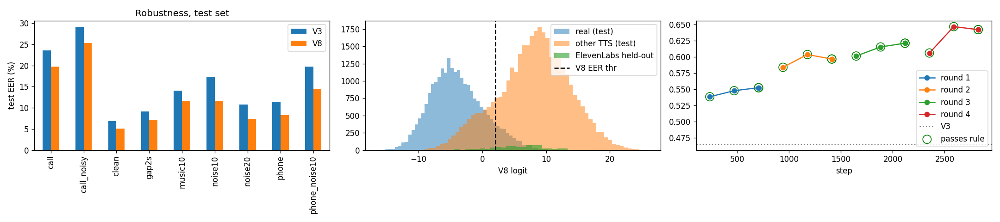

*Figure 4. V8b training output. Left: test EER by condition, V3 vs V8b. Middle: V8b test logits for real speech, other TTS and held-out ElevenLabs, with the EER threshold. Right: the validation objective at each check across the 4 rounds; V3's objective is the dotted line.*

### 5.4 Results before and after

**(a) Test set used by the V8b release gate** (held-out voices, TTS systems and speakers; each model at its own thresholds; EER = error rate where false alarms equal misses, lower is better):

| Metric | V3 | **V8b** | Gate limit | Result |
|---|---:|---:|---:|---|
| Pooled test EER, all conditions | 16.9% | **13.0%** | ≤ 17.9% | PASS |
| EER, clean audio | 6.9% | **5.1%** | ≤ 7.9% | PASS |
| EER, phone band (8 kHz / μ-law) | 11.4% | **8.3%** | ≤ 12.4% | PASS |
| EER, simulated call | 23.6% | **19.7%** | ≤ 24.6% | PASS |
| EER, simulated call + 10 dB noise | 29.1% | **25.3%** | ≤ 31.1% | PASS |
| EER, 20 dB noise / 10 dB noise | 10.8% / 17.3% | **7.4% / 11.7%** | | PASS |
| EER, 2 s silence gap / music at 10 dB | 9.2% / 14.1% | **7.1% / 11.7%** | | PASS |
| Unseen TTS systems detected (2% false-alarm threshold) | 54.2% | **67.8%** | ≥ 52.2% | PASS |
| Real speech flagged (EER threshold) | 13.7% | **9.8%** | ≤ 14.7% | PASS |
| LibriSpeech unseen speakers flagged (2% threshold) | 2.7% | 3.0% | ≤ 3.7% | PASS |
| LibriSpeech-100 test speakers flagged (2% threshold) | 2.13% | 2.14% | ≤ 3.13% | PASS |
| Non-speech probes flagged | 0.6% | 0.6% | ≤ 1.9% | PASS |
| **Held-out ElevenLabs detected (EER threshold)** | 60.8% | **81.3%** | must gain ≥ 5 pts | PASS |
| Benchmark clone calls ending "AI" (of 42) | 23 | **29** | | PASS |
| Benchmark human calls ending "AI" (of 28) | 0 | **0** | | PASS |

- The ElevenLabs gain is +20.5 points, with a 95% interval of **+10 to +31 points** (9 test voices, so the interval is wide).
- By group: V8b detected 80.4% of the 6 held-out library voices (V3 53.8%) and 82.9% of the 3 team clones (V3 73.6%).
- The phone channel is still the hardest case: on simulated calls V8b catches 25% of held-out ElevenLabs *windows* at the strict 2% threshold (V3 10%). Call-level verdicts work better because the evidence engine adds up many windows (section 7).

**(b) Fixed benchmark, all three deployed versions** (3 team voice clones + 2 LibriSpeech human speakers under 10 audio conditions; 666 windows; none of these voices were trained on):

| Model | Window accuracy | Balanced accuracy | Human windows flagged | ElevenLabs windows detected | AUC | EER |
|---|---:|---:|---:|---:|---:|---:|
| V2 | 76.0% | 71.8% | **52.9%** | 96.4% | 0.924 | 15.9% |
| V3 | 78.2% | 80.9% | 3.6% | 65.4% | 0.930 | 15.5% |
| **V8b** | **86.0%** | **87.8%** | **2.2%** | **77.7%** | **0.972** | **9.9%** |

| Subset | V2 detected / flagged humans | V3 | V8b |
|---|---|---|---|
| Original audio | 100% / 70% | 89.3% / 0% | **100% / 0%** |
| White noise only | 97.6% / 51.7% | 58.3% / 6.7% | **75.0% / 5.0%** |
| Simulated calls only | 89.3% / 42.5% | 32.1% / 7.5% | **42.0% / 3.8%** |

V2's high detection came from flagging most real people (53% of human windows). V3 fixed the false alarms but lost ElevenLabs detection. V8b improves both.

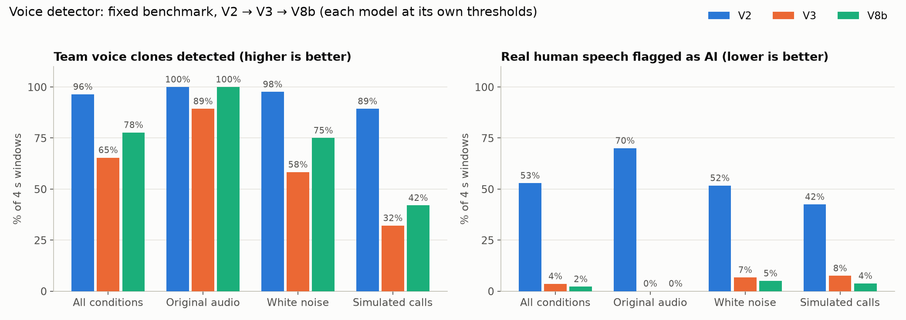

*Figure 5. The same benchmark as a chart. Left: share of cloned-voice windows caught. Right: share of real human windows wrongly flagged.*

**(c) The first model's own report (V2, Oct 10)** gave test EER 0.59% clean and 1.72% phone, AUC 0.999. Those numbers were **not** a real-world measure: the real-speech test split shared speakers with training (it was split by book), and every fake came from MLAAD. The later benchmark (table b) shows the honest picture.

**(d) Evaluation-only sets** (never trained on): OpenVoice V2 clone and MeloTTS clips were flagged in 99–100% of windows by both V3 and V8b (MeloTTS through the phone channel: V3 90.5%, V8b 97.3%). The robot call recorded through the live path was flagged in 100% of windows by both.

**(e) Alternative backbones were tested and rejected.** On Oct 24 the public AntiDeepfake detectors (NII Yamagishi lab; post-trained on about 74,000 hours) were compared with V3 on the same windows. In phone conditions at a 2% false-alarm threshold, the best one caught 5.5% of the team's ElevenLabs windows, against V3's 34.8%, and fusing it with V3 made V3 worse. The bottleneck is data and channel, not the backbone.

---

## 6. Pipeline 2: Transcript scam-language detector

### 6.1 Backend

All in the same cloud container:

1. **Vosk** `vosk-model-small-en-us-0.15` turns the caller's 16 kHz PCM (including silence) into text. Each call gets its own recognizer. Partial hypotheses replace earlier partials; only final utterances are appended. The rolling text is capped at 6,000 characters.
2. Every **5 s** (cloud setting `TRANSCRIPT_SCORE_EVERY_SEC=5`), if the text changed, the agent POSTs `{"transcript": "Caller: <text>"}` to the Node connector (`/v1/jev/probability`, port 3000), which forwards it to the model server (`/predict`, port 8000). One request at a time; newer text replaces queued text. Timeout 25 s; a score older than 35 s is marked *stale*.
3. The model server runs the JEV V2 ONNX model with ONNX Runtime on CPU.

Transcripts are not logged. A saved excerpt exists only if `SAVE_SCAM_TRANSCRIPTS=1` is set for a controlled, consented test (off by default).

### 6.2 Original model

- **Base architecture:** [`knowledgator/gliclass-modern-base-v2.0`](https://huggingface.co/knowledgator/gliclass-modern-base-v2.0), a GLiClass classifier on ModernBERT-base (151,378,177 parameters). It scores several candidate labels in one forward pass, with no text generation.
- **Starting checkpoint:** **OpenJev "Verdict"** ([`heman10x/rlcd-modernbert-151m`](https://huggingface.co/heman10x/rlcd-modernbert-151m), Apache 2.0), an open decision model inspired by TypeSafe AI's Jev. Its author post-trained the GLiClass base for calibrated choices with cross-entropy + Brier loss, an explicit "insufficient evidence" option, and temperature scaling, evaluated on Banking77 / CLINC150 intent tasks. It was not trained on scam calls.
- **How we use it:** one proposition with three candidate labels, built by `render_prompt()`:
  ```
  <<LABEL>>true: The caller is attempting to scam or defraud the other person.
  <<LABEL>>false: not The caller is attempting to scam or defraud the other person.
  <<LABEL>>insufficient evidence<<SEP>>Context:
  Caller: <latest 300 tokens of the transcript>

  Evaluate proposition: The caller is attempting to scam or defraud the other person.
  ```

### 6.3 Post-training (what we did)

| Pass | Started from | Data | Settings | Calibration |
|---|---|---|---|---|
| **V1 (call)** | OpenJev Verdict `model.safetensors` | 3,600 balanced calls: 1,200 each from three datasets (below) | Full model, 2 epochs, batch 4 × 4 accumulation, AdamW 2e-5, cross-entropy + Brier loss, last 300 transcript tokens, epoch chosen by validation NLL (epoch 2), Mac GPU | Temperature 2.278 on 361 validation calls |
| **V2 (caller-only)** — deployed | V1 | 3,599 caller-only versions of the same calls (only the caller's turns) | 1 epoch, LR 1e-5 | Temperature **3.012** |

V2 was made because the live pipeline transcribes **only the caller**, not both sides.

**Training datasets** (all public; all scores below are on synthetic or synthetic-style data):

| Dataset | Content | Used for |
|---|---|---|
| [Phone Scam Dataset](https://huggingface.co/datasets/menaattia/phone-scam-dataset) | ~4,000 short caller/receiver dialogues, scam vs legitimate (license not stated) | 1,200 train; 800 held-out test |
| [BothBosu scam-dialogue](https://huggingface.co/datasets/BothBosu/scam-dialogue) | 1,600 synthetic multi-turn calls, 4 scam + 4 benign types (Apache 2.0) | 1,200 train; 320 test |
| [Phone Scam Detection Synthetic](https://huggingface.co/datasets/shakeleoatmeal/phone-scam-detection-synthetic) | 1,800 synthetic scam / legitimate dialogues with subtlety variants (MIT) | 1,200 train; 361 validation; 180 test |
| [ICFD-31k](https://huggingface.co/datasets/rishia2220/icfd-31k) | 31,000 synthetic English/Hinglish calls | Cross-source stress test only (500 normal + 500 fraud) |
| [Kaggle Scam and Non-Scam Calls](https://www.kaggle.com/datasets/teeconnie/scam-and-non-scam-call-conversation-dataset) | 400 scam + 400 benign short transcripts (CC BY-NC-ND) | External test only |

Exact cross-split duplicates were removed. A similarity audit found 16 of 1,300 test calls (all BothBosu) with cosine similarity ≥ 0.8 to a training call. **We did not create our own transcript training data** for the deployed model; the team's own recorded calls were used to test the live path.

### 6.4 Results before and after

| Test set | Original OpenJev | V1 | **V2 (deployed)** |
|---|---:|---:|---:|
| Held-out calls from the 3 training-source families (n = 1,300), accuracy | 46.5% | 99.5% | 98.5% |
| Same, Brier score (lower is better) | 0.2591 | 0.0042 | 0.0128 |
| ICFD cross-source stress test (n = 1,000), accuracy | 44.7% | 87.8% | **88.1%** |
| Kaggle short-call external test (n = 800), accuracy | 40.5% | 72.5% | **79.6%** |
| Kaggle scam recall | — | 53.8% | **69.3%** |
| Kaggle 10-bin calibration error | — | 0.217 | **0.144** |
| Original Jev decision task (n = 500), retention | 56.4% | 69.0% | 67.6% |
| Caller-only validation accuracy | — | 90.0% | **98.3%** |
| ICFD clear-normal specificity | — | 93.2% | 80.2% |

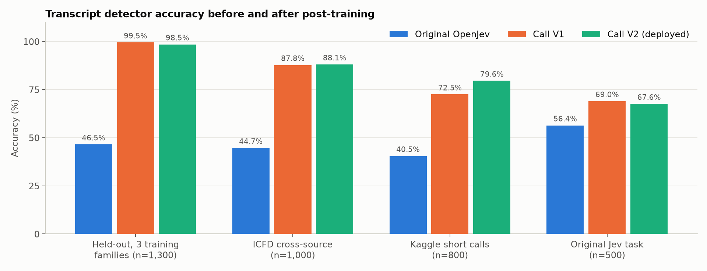

*Figure 6. Transcript-model accuracy on each test set, before (original OpenJev) and after our two post-training passes.*

V2 trades some specificity on ICFD normal calls for better recall on short, caller-only text, which is what the live pipeline sends.

**Live-path checks.** In a controlled call on Oct 19 through Google Voice → callma., a synthesized fictional scam script (urgent transfers, verification codes, gift cards) reached **99%**, and a synthesized benign script stayed at **3–5%**. An 18-second live human call ended at 8%.

**Research candidates (not deployed).** Later passes trained on recorded material: FTC/NCSU robocall transcripts, Switchboard conversations and Harper Valley Bank roleplays. **V5** was the best candidate (0/10 recorded scams missed and 0/21 natural conversations falsely flagged at the 0.75 threshold in window mode; 1/40 banking roleplays falsely flagged), but the recorded scam test had only 10 calls from 4 script groups, so it was kept as research. V4, V6 and a guarded V7 were rejected for regressions. The deployed service still runs V2 in "tail" mode (last 300 tokens).

---

## 7. Inference, scoring and thresholds in detail

### 7.1 Voice: from audio to one window score

Code: `audio_window.py` (`VoicedWindow`), `scoring.py` (`AudioScoringSession`), `detector_adapter.py`.

1. **Buffer.** Caller PCM goes into a 4-second ring buffer (64,000 samples). Natural pauses stay in the window; nothing is cut out.
2. **Speech gate.** Each frame is marked as speech or not. The deployed default is a fixed energy gate (frame RMS ≥ 0.01, about −40 dBFS). A trained Silero VAD gate exists (`SPEECH_GATE=silero`) but is not the default yet.
3. **A window is eligible only if** the buffer is full, at least **1.5 s** of it is speech, no more than **5%** of samples are clipped (|x| ≥ 0.99), and it contains no run of exact digital silence longer than **0.2 s**. (Digital zeros made real human speech score as strongly AI in testing, so those windows are skipped.)
4. **Scheduling.** The agent checks every **1 s**. It submits a window only when at least **4 s of new audio** has arrived since the last submitted window and no inference is in flight. Windows therefore do **not overlap**: one score per 4 s of audio, and no audio is counted twice. If inference is slow, windows are skipped rather than queued.
5. **Model.** The window is z-normalized and scored. The raw **logit `z`** is kept in float64. (Probabilities are useless near 1.0 because float32 rounds them to exactly 1.)
6. **Weight.** Each window gets a weight `w` = fraction of its samples marked as speech (0–1).
7. **Silence.** After 6 s without speech, the audio buffer is cleared, but the call's evidence and verdict are kept.
8. **Failures.** An inference taking longer than 10 s is reported as *unavailable*; a model failure leaves the call working.

### 7.2 Voice: compounding windows into a call verdict

Code: `risk.py` (`CallEvidenceEngine`, method `call-evidence-v1`).

Let `a` and `b` be the two logit thresholds in use (elevated and high; see 7.4). Then:

```
center = (a + b) / 2
scale  = max( (b − a) / (2 · logit(0.65)), 0.25 )        logit(0.65) = 0.619

for each scored window i:
    e_i  = clamp( (z_i − center) / scale , −4, +4 )      bounded evidence
    mean = Σ w_i · e_i  /  Σ w_i                          speech-weighted, whole call

AI score = round( 100 · sigmoid(mean) )                   0–100, shown in the app
```

Clamping to ±4 means a single extreme window cannot dominate.

**Verdict rules**

| Rule | Behavior |
|---|---|
| First verdict | Needs **2** scored windows. AI score ≤ 35 → **Human**; ≥ 65 → **Likely AI**; otherwise **Inconclusive** |
| Changing a verdict | Needs **2 consecutive** windows whose running score supports the new label (hysteresis) |
| Recent-AI warning | Over the last **5** windows (about 20 s of speech): at least 3 windows individually ≥ 65 **and** their weighted mean ≥ 65. Shown as a separate warning so a long human-sounding introduction cannot hide a later switch to a cloned voice. It does not relabel the whole call |
| 15-second deadline (app) | 15 s after the call connects, if fewer than two windows have arrived, the app shows **Inconclusive** (keeping any one-window score). It never invents a Human/AI label without audio |
| `max_ai_run` | Longest run of consecutive AI-like windows, kept for evaluation |

The app maps the states to *Sounds human* (blue), *Not sure yet* (amber) and *Likely AI* (red), with the AI score as a percentage and a bar.

**Worked example (deployed V8b, recommended thresholds).** With `a = −0.289` and `b = 4.320`: center = 2.016 (V8b's EER threshold), scale = 3.723. A window with logit 9.5 (near the middle of the TTS distribution in Figure 4) gives e = +2.01; one with logit −5 (near the middle of the real-speech distribution) gives e = −1.88. Two clone-like windows → AI score `100·sigmoid(2.01)` = 88 → **Likely AI**. Two real-speech windows → 13 → **Human**.

### 7.3 Words: from transcript to a score

1. The prompt (6.2) is tokenized; if the caller text is longer than 300 tokens, only the **last 300** are used ("tail" mode).
2. Text with fewer than 4 meaningful words returns *insufficient evidence* (no score) instead of a low score.
3. The model outputs logits for "true", "false" and "insufficient evidence". The probability is
   ```
   P(scam) = sigmoid( (logit_true − logit_false) / T ),   T = 3.0118  (V2)
   ```
4. The app shows the **highest probability seen so far in this call**; it cannot go down during the call. Bands: **< 0.40** *No scam language* (blue), **0.40–0.75** *Some warning signs* (amber), **≥ 0.75** *Scam language* (red).

### 7.4 How the thresholds are chosen

**Voice model.** Thresholds are picked on **validation** data only and then frozen before the test set is scored:

- Validation windows are pooled over every audio condition (clean, phone, simulated call, noisy call, noise, silence gap, music) because live calls use one threshold for everything.
- Scores are raw float64 logits.
- **EER threshold** (`logit_threshold_eer`): the logit where the false-alarm rate on real speech equals the miss rate on AI speech. V8b: **2.016**.
- **1% and 2% false-alarm thresholds**: the logits above which 1% / 2% of validation real-speech windows fall. V8b: **6.625** and **5.719**.
- **Call thresholds.** Using the EER and 1% thresholds directly centers the call score at 4.32, which sits too high for phone-channel clones: on the benchmark only 10 of 42 clone calls ended *Likely AI*. The release report therefore recommends **re-centered** thresholds that put the center exactly on the EER threshold with the same spread: `THRESHOLD_ELEVATED_LOGIT = −0.289`, `THRESHOLD_HIGH_LOGIT = 4.320`. With these, 29 of 42 clone calls end *Likely AI* and 0 of 28 human calls do.
- **To check:** `detector_config.json` stores these as `recommended_call_engine_env`, but the agent reads only the environment variables. The repository's deploy command does not set them, so they must be set as LiveKit secrets; I could not confirm from the repository that they are.

**Transcript model.** The temperature (3.012) was fitted on held-out validation calls. The 0.40 / 0.75 / 0.90 levels in the app are product settings chosen by the team, not values fitted to real calls; 0.75 is *not* a verified 75% chance of fraud.

**Combining the two.** The app's header takes the most serious finished result. Mixed cases have their own wording, for example a human voice with scam language → *Likely scam: "The voice sounds human, but a real person can still be a scammer."* The backend also computes a combined label (`combine()` in `risk.py`): voice *high* + transcript ≥ 0.8 → `prevention`; transcript ≥ 0.8 with a low voice level → `elevated`. That label is informational: no detector score ever blocks a call or sends a message on its own.

---

## 8. Latency

### 8.1 Model inference per unit

| What | Hardware | Time per call of the model | Source |
|---|---|---|---|
| Voice model, one 4 s window | NVIDIA L4 GPU (Colab) | **15.7 ms** (V3, same architecture as V8b); 12.8 ms (V2) | Oct 24 backbone comparison; V2 training notebook |
| Voice model, one 4 s window | Colab CPU, 12 threads | **274 ms** (V3); 265 ms (V2) | same |
| Voice model, one 4 s window | M5 Pro MacBook Pro, Apple GPU (MPS) | **≈20 ms** median, 20.6 ms p95; first call after start-up 1.5 s (kernel compile) | Oct 22 benchmark harness |
| Voice model, one 4 s window | LiveKit Cloud container, 2 CPU threads (deployed) | not measured directly; slower than the 12-thread figure. Any window over 10 s is reported *unavailable* | — |
| Transcript model, short text (9 words) | 2-vCPU Intel Xeon 2.1 GHz, ONNX Runtime (measured for this document with the deployed V2 file) | **300 ms** median | `bench_jev.py`, Oct 25 |
| Transcript model, full 300-token context | same | **1.21 s** median, 1.28 s p90 | same |
| Transcript model, typical inputs | Mac CPU | ≈32 ms mean (tail mode) | Oct 20 transcript report |
| Recording notice | — | 1.9 s clip | measured from the generated WAV |

The deployed voice model processes 4 s of audio far faster than real time on every measured device (about 15× faster than real time even at 274 ms on CPU). On the 2-thread cloud CPU the transcript model's full-context pass takes about a second, which fits inside its 5 s scoring interval. The cloud container's exact CPU and per-window times are reported by the deployment probe but were not available to me, so treat the cloud figures as unmeasured.

### 8.2 Time to the first result on a call

Inference is small next to the time needed to *hear enough audio*. For a caller who talks continuously from the moment the call is answered:

| Step | Typical time after the senior taps Accept |
|---|---|
| Recording notice ("This call is being recorded.") | ≈ 2 s (1.9 s clip, then playback drains) |
| First eligible 4 s window of caller audio | notice + 4 s (needs ≥ 1.5 s of speech in it) |
| Wait for the next 1 s scheduling check | + 0–1 s |
| Inference + publish to the app | + well under 1 s |
| **First voice score** (one window) | ≈ 6–7 s |
| **First voice verdict** (needs 2 windows) | ≈ 10–11 s |
| Later updates | one new window every 4 s of caller audio |
| App deadline | at 15 s after connect, *Inconclusive* if fewer than 2 windows |
| **First transcript score** | after Vosk finalizes words and the next 5 s scoring tick; usually within the first several seconds of speech, but scam *content* often appears later: in recorded FTC robocalls the 0.75 level was first crossed at 20–30 s into the call |

These times are derived from the code's fixed settings. End-to-end timing on real PSTN calls (network, Vosk speed on the cloud CPU) has not been measured with a stopwatch, so treat the totals as estimates.

---

## 9. What the user sees: the app

All screenshots were captured on October 25, 2026 from the current build (iPhone 18 Pro Max simulator, iOS 27) using the app's built-in UI-test fixtures, so the names, numbers and scores on the call screens are test values, not a real call. The call-screen card is the redesign merged on October 25 (commit `787be7a`).

### 9.1 Everyday phone screens

The app looks like the standard iPhone Phone app on purpose: Favorites, Recents, Contacts, Keypad and Settings tabs, large type, and the lowercase **callma.** wordmark.

**Recents.** Call history with All / Missed filters and search. Saved calls keep their voice and transcript results.

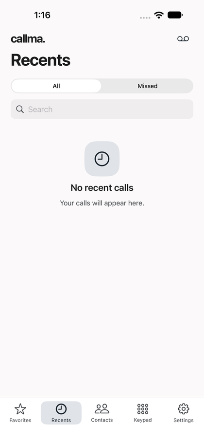

**Contacts.** Trusted Guardians sit at the top and work without Contacts permission.

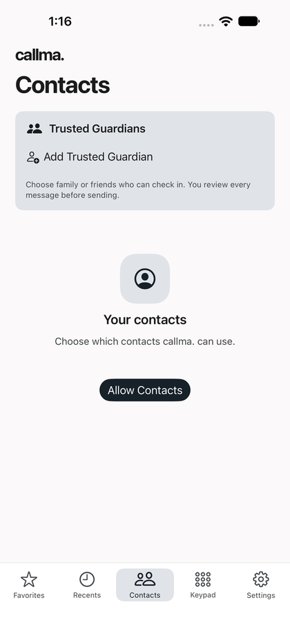

**Keypad.** Outgoing calls use the mobile service unless the optional outbound gateway is set up.

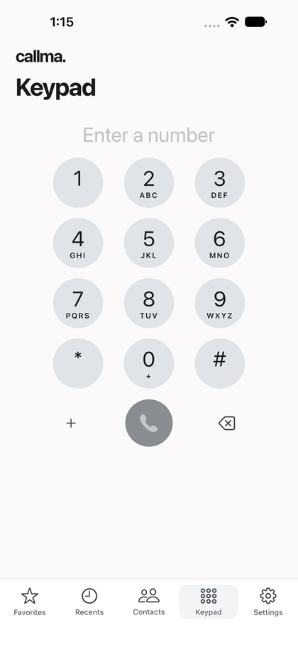


**Settings.** Calling connection card with the forwarding status and the callma. line, plus System / Light / Dark appearance.

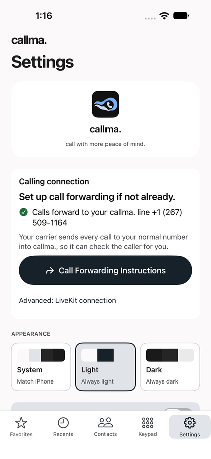

**Call Forwarding helper [local, uncommitted].** Four steps: your number, your carrier, the exact code to dial, and how to undo it.


**Blocked Numbers.** Personal blocks and reviewed community blocks, listed separately.

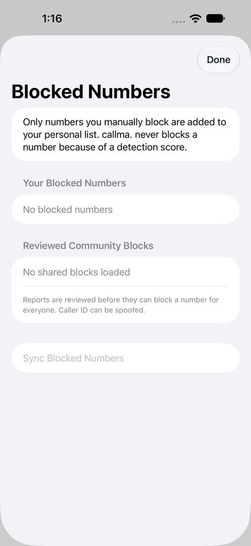


### 9.2 A call, step by step

**1. Incoming.** The app's own incoming-call screen (CallKit on a real iPhone).

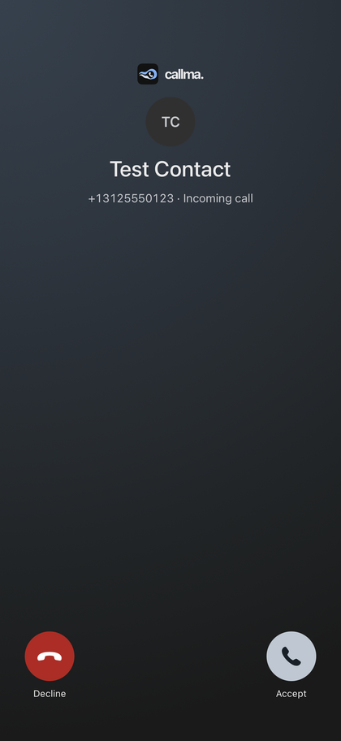

**2. Checking.** Right after pickup both checks run; each bar sweeps until it has a result.

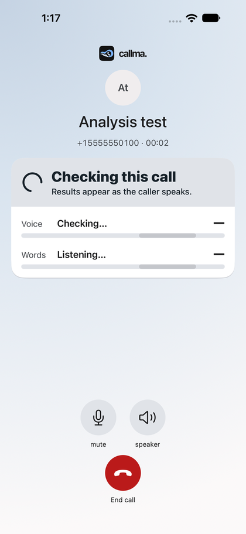

**3. Warning signs.** Voice *Not sure yet* (74) and words *Some warning signs* (74): amber header, no Alert Guardian button yet.

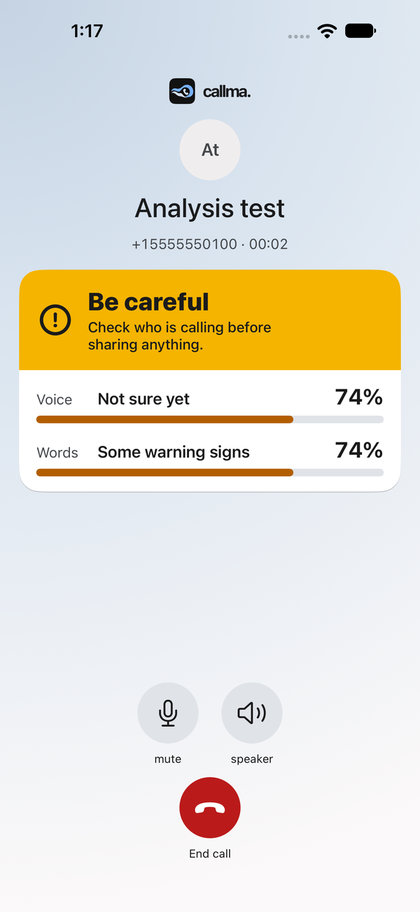


**4a. Scam language, human voice.** Voice *Sounds human* (12) but words *Scam language* (94). The header warns that a real person can still be a scammer.


**4b. AI voice, normal words.** Voice *Likely AI* (75) while the words look normal: *Possible fake voice. Verify who is calling.*


**4c. 15-second deadline.** No voice verdict after 15 s, so the voice row stays *Not sure yet* without an invented score while the words result is shown.

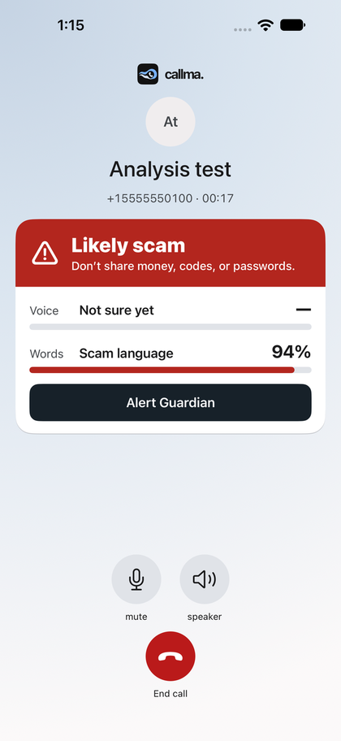


### 9.3 Safety actions

**Alert Guardian.** Pick a guardian, choose whether to include a transcript excerpt (off by default), review the message, then send it yourself.

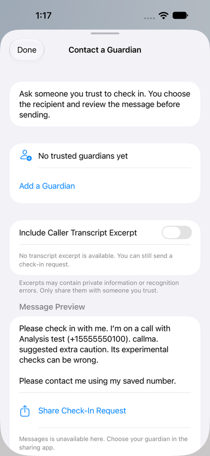

**Pause Before Sharing.** Shown once when the user comes back to a very-high-score call after leaving the app.

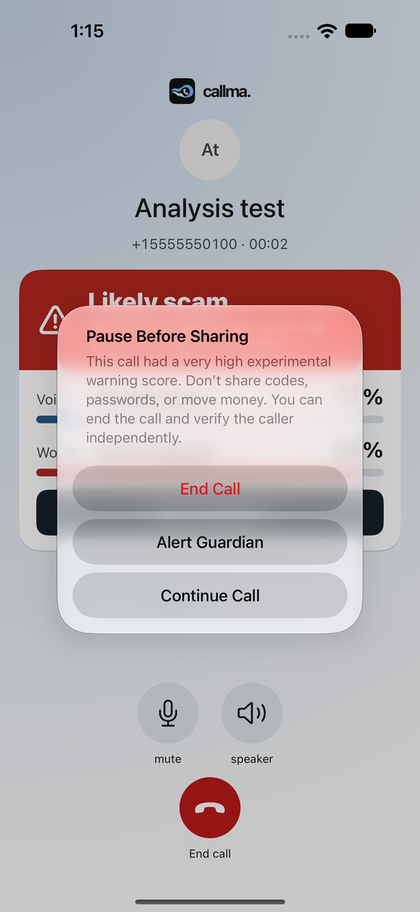

**Accessibility.** At the largest text sizes the card and controls grow and the screen still fits without scrolling.

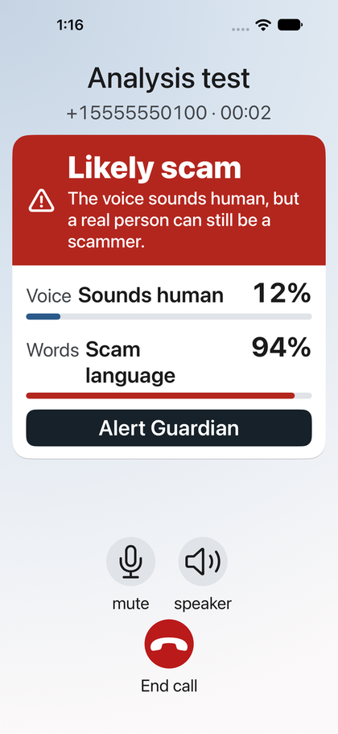


### 9.4 How the call card decides what to say

| Voice result | Words result | Header | Advice shown |
|---|---|---|---|
| still checking | still checking | Checking this call | Results appear as the caller speaks. |
| Sounds human | No scam language | No strong signs | Stay alert. This doesn't prove who is calling. |
| Not sure yet, or words 40–74 | (not high) | Be careful | Check who is calling before sharing anything. |
| any | Scam language (≥ 75) | Likely scam | Human voice: "The voice sounds human, but a real person can still be a scammer." Otherwise: "Don't share money, codes, or passwords." |
| Likely AI | normal | Possible fake voice | The words sound normal, but the voice may be AI. Verify who is calling. |
| Likely AI | Scam language | Likely scam | Don't share money, codes, or passwords. |
| unavailable | unavailable | Checks unavailable | Your call can continue. Verify who is calling before sharing anything. |

Red = high, amber = caution, calm blue = low. **Alert Guardian** appears with any red result or a score of 75 or more on either check.

---

## 10. Safety features beyond detection

### 10.1 Trusted guardians

- **Contacts → Guardians** section (works without Contacts permission). Add a name and an international number, or pick a contact. Duplicates update the existing guardian; removal asks for confirmation.
- Stored in a protected, backup-excluded file on the iPhone. Adding a guardian contacts no one.
- **Alert Guardian** appears on the call screen when either check reaches its high level (voice *Likely AI*, or transcript ≥ 0.75). It opens a recipient picker and a full message preview, then Messages with the reviewed text. **The user must tap Send.** A transcript excerpt is excluded by default and can be included only when a real saved excerpt exists. If Messages cannot send, the share sheet is offered.

### 10.2 "Pause Before Sharing" reminder

iOS does not let an app stop the user from leaving a call screen. If the user leaves the app during a call with a very high score (≥ 0.90 on either check), callma. shows one reminder when they return: *"Don't share codes, passwords, or move money. You can end the call and verify the caller independently,"* with **End Call**, **Alert Guardian** and **Continue Call**.

### 10.3 Manual blocking and reporting

- After a call, its details offer **Block for Me**, **Block and Report**, or **Report for Review**.
- Local blocks take effect immediately for callma. calls on that iPhone and survive restarts.
- With the safety service configured, blocks sync to the server and the agent checks them **before ringing**: a blocked caller is disconnected without the phone ringing.
- A report alone never blocks. A shared block for all users needs a separate admin token and a written review reason, because caller ID can be spoofed and reports can be wrong.
- Detector scores never create blocks or reports.

### 10.4 Honest wording and states

- Scores are described as scores out of 100 with a limitation line, never as confirmed scam probabilities.
- *Not enough to judge* (insufficient evidence) carries no score and is not treated as safe.
- *Checking…* (with a moving bar), *Updating…* (stale), *Unavailable* and *Off* are separate states; a failure never looks like a safe result.
- The voice check shows its previous result while it re-analyzes after a pause.

### 10.5 Stop checking a sensitive call **[local, uncommitted]**

The senior can stop both checks for the rest of a call. The agent then stops scoring and transcription and discards the caller recording for that call; the app accepts no later results and drops any transcript excerpt. The backend, wire contract and coordinator are written; the call-screen button is not in the committed UI yet.

### 10.6 Accessibility and design for older adults

Large type that scales with Dynamic Type; the call screen never scrolls (it drops the logo and avatar, then caps text size until everything fits); controls of at least 44 points with text labels; Reduce Motion replaces the sweeping bar with a pulse; VoiceOver labels on scores; light and dark appearances.

---

## 11. Privacy, consent and security

- **Disclosure.** Every answered call starts with "This call is being recorded." Analysis does not start until the notice has finished. The notice is a disclosure, not a consent check.
- **Recording.** **On** in the current code and deployment for testing (`agent.py` defaults `RECORD_CALLER_AUDIO` to `1`, and the deploy command sets it) to collect phone-channel data from consenting testers. Set it to `0` before any use with people who have not agreed. (Some older READMEs still say it defaults to off.) Only the caller's audio is saved. Illinois requires all-party consent, so recording must only be used on calls where everyone agreed.
- **Only the caller is analyzed.** The agent subscribes to the SIP caller's audio, never the senior's microphone.
- **No transcripts in logs.** Vosk text, transcript bodies, PCM and tokens are never logged; the model server binds to `127.0.0.1` only.
- **Credentials.** The LiveKit API secret stays in GitHub Actions and LiveKit Cloud. The app holds a lobby token (keep it out of git; short lifetimes for demos) and receives a 10-minute token per call that can only join that room, listen, publish a microphone and (new) set its own attributes, never publish data.
- **Model integrity.** Startup verifies SHA-256 hashes of the voice checkpoint, its config and the architecture file, and of the JEV bundle (model, tokenizer, calibration together). The cloud build downloads only checksum-pinned release assets through expiring URLs; the GitHub token never reaches LiveKit's builder.
- **Licenses.** MLAAD (CC BY-NC 4.0), ESC-50 (CC BY-NC), Kaggle calls (CC BY-NC-ND), and one transcript source with no stated license: fine for a student competition, but they restrict commercial use. ElevenLabs' terms on training with generated audio should be checked.

---

## 12. Testing and verification

| Area | What is tested | Where |
|---|---|---|
| Voice release gate | 19 rows written before the run; V8b passed all | `posttrain_report_v8b.json` (release `deepfake-weights-v8`) |
| Backend unit/integration | Ring supervisor (24 tests), agent orchestration, cumulative scoring, speech gates, calibration loading, recording notice, transcript pipeline, safety service (9), outbound gateway (4), Drive upload | `LiveKit Setup/test_*.py`; *Call pipeline* workflow on every push |
| Cloud deploy | Builds with real models, deploys, then a real audio probe through the live agent must return a real voice score and a fresh transcript probability | *LiveKit real models* workflow |
| iOS | 89 tests: 70 unit + 19 UI (state machine, wire-contract fixtures generated by the Python engine, 14.999 vs 15.000 s deadline, guardian, blocking, call-screen states). Run on Oct 25 for this document against the local checkout (with uncommitted changes): 86 passed, 3 UI tests failed. The committed `main` passed the *Callma simulator* workflow the same day | `ios/CallmaTests`, `ios/CallmaUITests` |
| Transcript training safety | Leakage and objective-weight checks for new training runs | *JEV training safety* workflow |
| Live calls | Oct 19 controlled calls through Google Voice: synthesized speech → *Likely AI* on both benign and scam scripts; scam script 99% / benign 3–5%; 18 s human call → *Likely human*; silence recovery, mute/speaker, hang-ups, saved history | `docs/testing/2026-10-19/REPORT.md` |

---

## 13. Known limitations

1. **No independent real-call false-alarm measurement for V8b.** All 9 real call recordings were trained on, and 8 of the 9 came from one phone number. Fresh consented calls from new speakers are the next test.
2. **Phone audio is the weak spot.** Even V8b catches only about a quarter of cloned 4-second windows on simulated calls at a strict threshold. The call-level engine helps, but 6 of 42 benchmark clone calls still ended *Human* and 7 *Inconclusive*.
3. **Few ElevenLabs voices.** 24 voices plus 3 clones; the ElevenLabs gain has a wide confidence interval (+10 to +31 points).
4. **Simulated, not recorded, calls** in most training and testing. AMR-NB (common on mobile networks) was not simulated.
5. **Thresholds are heuristic.** No Platt calibration on real calls yet; the voice score is not a probability, and the recommended call thresholds must be set in the deployment (7.4).
6. **Transcript model trained on synthetic dialogues.** Real scam scripts, accents and Vosk errors may lower accuracy. English only.
7. **Foreground-only ringing.** No push notifications, so the app must be open. A decline leaves the caller ringing until the ring window ends; no voicemail.
8. **Single user.** One senior identity per deployment; the safety service is a single SQLite store.
9. **Neither check verifies identity.** A human scammer passes the voice check; a family member can use urgent words.

---

## 14. Reference: settings, files and endpoints

### 14.1 Agent and model-server settings

| Variable | Cloud value | Meaning |
|---|---|---|
| `DETECTOR` | `remote` | `remote` = loopback model server; `real` = load locally; `stub` = fake scores |
| `DETECTOR_DEVICE` | `cpu` | |
| `OMP_NUM_THREADS`, `MKL_NUM_THREADS` | `2` | PyTorch threads (also `torch.set_num_threads(2)`) |
| `SCORE_EVERY_SEC` | `1.0` (default) | How often the agent checks for a new window |
| `SPEECH_GATE` | `fixed` (default) | `fixed`, `adaptive` or `silero` |
| `DIGITAL_SILENCE_MAX_SEC` | `0.2` (default) | Max exact-zero run allowed in a window |
| `THRESHOLD_ELEVATED_LOGIT`, `THRESHOLD_HIGH_LOGIT` | recommended `-0.289`, `4.320` | Call-engine thresholds; otherwise `detector_config.json` EER / 1% values |
| `CALIBRATION`, `CALIBRATION_PATH` | not used | Optional Platt calibration bound to the checkpoint hash |
| `TRANSCRIPT_ENABLED` | `1` | |
| `VOSK_MODEL_PATH` | `/app/models/vosk-model-small-en-us-0.15` | |
| `TRANSCRIPT_SCORE_URL` | `http://127.0.0.1:3000/v1/jev/probability` | |
| `TRANSCRIPT_SCORE_EVERY_SEC` / `_TIMEOUT_SEC` / `TRANSCRIPT_MAX_AGE_SEC` | `5` / `25` / `35` | |
| `JEV_MODEL_URL`, `JEV_TIMEOUT_MS` | `http://127.0.0.1:8000/predict`, `20000` | Connector → model server |
| `RECORD_CALLER_AUDIO`, `RECORD_DIR` | `1`, `/tmp/cac-recordings` | Testing only |
| `SAVE_SCAM_TRANSCRIPTS` | `0` | Controlled tests only |
| `SENIOR_IDENTITY`, `SENIOR_LOBBY_ROOM`, `RING_TIMEOUT_SEC` | `senior`, `senior-lobby`, `30` | |

### 14.2 Wire contracts

- **Invite** (agent → app), topic `callshield.incoming`, reliable, to identity `senior`: `{"type":"incoming_call","callUUID","room","token","handle","callerIdentity"}` (optional `callerName`).
- **Results** (agent → app), topic `scam-guard.risk`: schema 1 envelope with `room`, `callerIdentity`, `streamID`, increasing `sequence`, `model`. `type: risk` carries `deepfake` (`method: call-evidence-v1`, `state`, `score`, `score_kind: heuristic`, `recent_ai`, `max_ai_run`, `p_last`, `logit_last`, …) and `transcript` (`state`, `probability`, `revision`, `age_sec`). `type: status` carries `waiting | analyzing | unavailable` with a reason. The app only accepts messages from a LiveKit agent participant.
- **Stop checking** (app → agent) **[local, uncommitted]**: participant attribute `callma.analysis = "stopped"`.

### 14.3 Model files

| File | Where | SHA-256 |
|---|---|---|
| `detector_state_v8b.pt` (659 MB) | release `deepfake-weights-v8` | `cc6a75eae2948aeae5f491dffbc0e05af274bb4d8f6740451ad762b72f9703d5` |
| `detector_config.json` | `backend/AI Deepfake Pipeline/` | `43036171fca5295ecc5483b038673075a98323d70ddbe1e5e11e9753820db421` |
| XLS-R architecture `config.json` (rev `1a640f32`) | `backend/AI Deepfake Pipeline/architecture/` | `0bffa0d0e98153e883b828d86491f3c6062cb563dc9d7a9cfd1790da30c286ac` |
| `jev-call-v2-model.onnx` (606 MB) | release `jev-call-models-v1-v2` | `8f7bbb21ce135765d4de33d7fc3f5947d31826424249018a6671d0b611541c8a` |
| `jev-call-v2-calibration.json` | same | `1b13be92f629997502aea80185f8c3ec556098c7d78596309ddf050fbcbc4e4f` |
| `vosk-model-small-en-us-0.15.zip` | alphacephei.com | `30f26242c4eb449f948e42cb302dd7a686cb29a3423a8367f99ff41780942498` |

### 14.4 Training notebooks and reports

- `backend/AI Deepfake Pipeline/training/Fine_Tuning_XLS_R_for_AI_Deepfake_Detection_CAC_English_v2.ipynb` (V2, saved with outputs)
- `backend/AI Deepfake Pipeline/training/Posttrain_XLS_R_Deepfake_CAC_v3.ipynb` (V3)
- V7, V8 and V8b notebooks: Colab (`MyDrive/CAC_deepfake_detector`); V8b reports in release `deepfake-weights-v8`
- `backend/jev-posttrain/` (transcript training scripts and README), `docs/testing/2026-10-20-transcript/`, `docs/testing/2026-10-22-jev/`

### 14.5 External sources

- XLS-R: [model card](https://huggingface.co/facebook/wav2vec2-xls-r-300m) · [paper](https://arxiv.org/abs/2111.09296) · [Meta announcement](https://ai.meta.com/blog/xls-r-self-supervised-speech-processing-for-128-languages/)
- [MLAAD](https://arxiv.org/abs/2401.09512) · [LibriSpeech (OpenSLR 12)](https://www.openslr.org/12) · [ESC-50](https://github.com/karolpiczak/ESC-50)
- [AntiDeepfake post-training paper](https://arxiv.org/abs/2506.21090)
- [OpenJev / Verdict](https://github.com/Heman10x-NGU/Verdict-open-jev) · [GLiClass ModernBERT base](https://huggingface.co/knowledgator/gliclass-modern-base-v2.0)
- [Vosk models](https://alphacephei.com/vosk/models)
- LiveKit: [dispatch rules](https://docs.livekit.io/telephony/accepting-calls/dispatch-rule/) · [phone numbers](https://docs.livekit.io/telephony/start/phone-numbers/) · [codecs](https://docs.livekit.io/reference/telephony/codecs-negotiation/)
