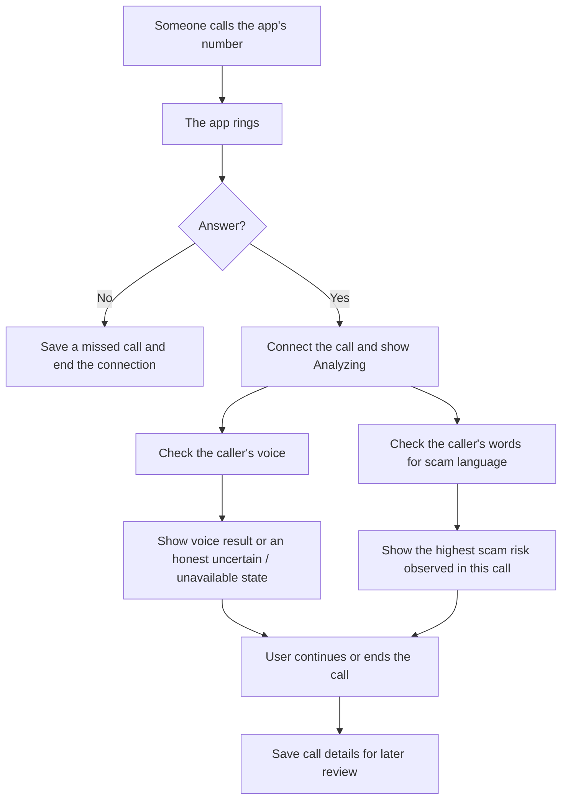

# What happens when a call arrives

The user sees who is calling, a voice result, a separate scam warning, and large call controls. Call history preserves assessments. Optional transcript excerpts appear only in call details, after a flagged call, when the server option is enabled for previously consented controlled tests. No live transcript is displayed.

Current calling service supports incoming calls while the app is open. Outgoing calls use the phone's normal service and are not analyzed. The call-start notice and automatic consent gate are unfinished. A voice result is not identity verification. This diagram describes the production iPhone path; `frontendscreens/` is a simulated React prototype.
