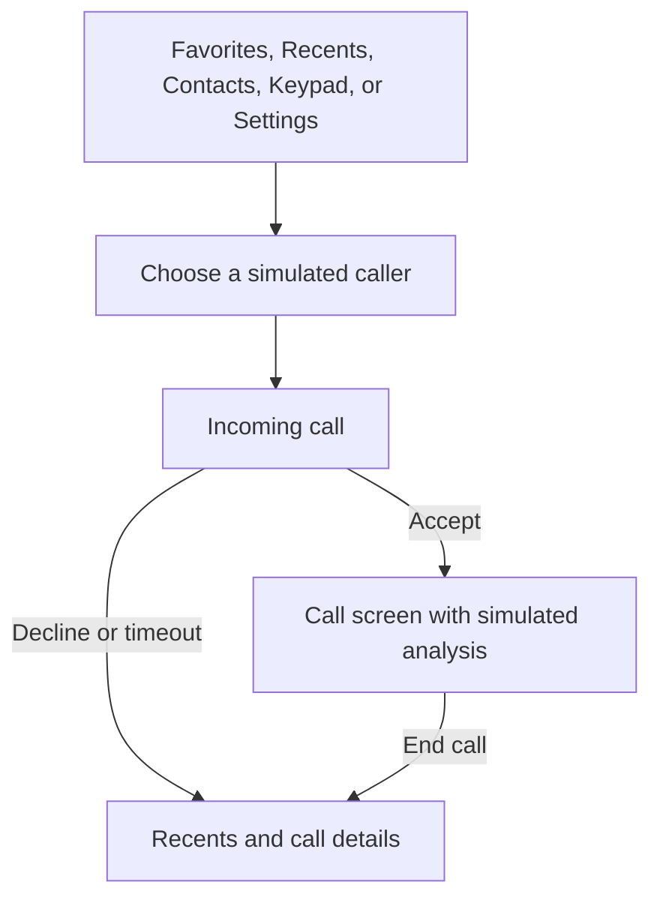

# callma. frontend screens

**call with more peace of mind.**

Blue, teal, coral, and warm yellow accents; all logo slots and the favicon are placeholders.

iPhone-style React demo with Favorites, Recents, Contacts, Keypad, and Settings. Calls and AI results are simulated.

## Run

In this folder: `npm install`, then `npm run dev`.
Check: `npm run lint`. Build: `npm run build`. Deploy the resulting `dist/` folder.

## Screen flow

For the real iPhone call pipeline, see [the production call flow](../docs/meeting-2026-10-20/CALL-FLOW.md).

## Code for each screen

- `RecentsScreen.tsx`: initial screen, All/Missed filters, search, and call history. A row opens details, never a callback.
- `ContactsScreen.tsx`: sample caller identities; each opens Contact Details.
- `SettingsScreen.tsx`: larger text and demo service status. Voice explanations open beside results.
- `KeypadScreen.tsx`: number entry, deletion, international prefix, and a blocked demo Call action.
- `CallScreen.tsx`: Incoming Call when `active.stage` is `ringing`; Active Call when it is `connected`. The ringing screen shows Accept/Decline with no analysis. The active screen shows analysis, elapsed time, simulated mute/speaker controls, and End Call.
- `DetailDialog.tsx`: Demo Picker when `demo` is true; otherwise Call Details or Contact Details according to `detail`. Done, Escape, and backdrop click return to the previous screen.
- `App.tsx`: shared state, navigation, timers, desktop introduction, phone shell, and dialog coordination.
- `shared.tsx`: types, fictional sample data, duration formatting, and VoiceBadge.
- `phone.css`: full responsive styles. `index.css`: base styles and Tailwind import.
- `main.tsx` and `index.html`: entry point. `package.json`, `tsconfig.json`, and `vite.config.ts`: dependencies and build settings.

## Detection happens during the call

1. Ringing: no analysis starts or appears; voice state is Unknown.
2. Accept: the connected call starts its duration clock and displays Analyzing voice.
3. After 2.6 seconds of the accepted call, the simulated result becomes Likely AI, Likely human, or Unknown.
4. End: cancel pending analysis and save the finished assessment to Recents, or Unknown if it did not finish.
5. Decline or 30-second timeout: save a missed call as Unknown; never classify it.

## Prototype limits

No real phone calls, microphone access, audio transmission, or AI classification service is connected. Mute/speaker controls change demo state only. History and preferences reset on reload. Real services must start analysis after acceptance and stop on call end. Likely human does not verify identity or safety, and Likely AI does not mean scam. The dialer and contact Call actions display a demo-only explanation; no real outgoing call is placed. Favorites are session-only.
