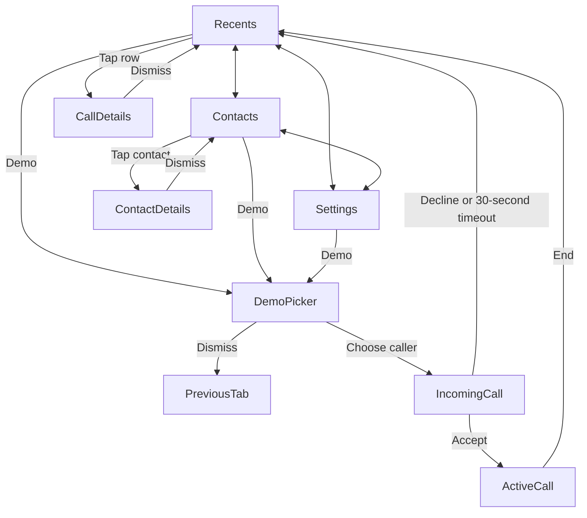

For the MacBook simulator handoff, start with [MACBOOK_TESTING.md](../MACBOOK_TESTING.md).

# Callshield for iPhone

Native SwiftUI implementation of the `azim` branch’s Callshield frontend, with separate demo and production interfaces. Build with **Xcode 26 or later** (LiveCommunicationKit requires the iOS 26 SDK); deployment supports **iOS 16 or later**. The only package dependency is the LiveKit Swift SDK (exactly 2.17.0), which Xcode downloads when the project is first opened. The iPhone does not download voice-model weights; the LiveKit agent runs the detector.

## Switch demo / production

`CALLSHIELD_DEMO` selects the interface: **`true`** for the existing TSX demo, **`false`** for the production phone interface. The checked-in default, in `Configuration/Callshield.xcconfig`, is `false` (production). To change it, copy `Configuration/Local.xcconfig.example` to `Configuration/Local.xcconfig`, uncomment `CALLSHIELD_DEMO = false` there, then rebuild. One value applies to both Debug and Release. It is expanded into Info.plist and read by `App/AppConfiguration.swift`.

`Local.xcconfig` is gitignored and is included last by `Callshield.xcconfig`, so the settings you uncomment there override the checked-in defaults; a fresh copy of the example changes nothing. It is the place for everything specific to you: mode, development team, bundle identifier and LiveKit values. Do not change these in Xcode’s Build Settings or Signing & Capabilities editors. Xcode stores such edits in the tracked `project.pbxproj`, where they override both xcconfig files and are lost when the project is regenerated.

The two modes own different stores. Production never reads the demo’s fictional contacts/history, simulated timers or results. Debug-only UI test arguments select a mode and isolate production persistence; Release ignores these arguments.

## Run

1. Open `Callshield.xcodeproj` from this folder.
2. Select the **Callshield** scheme and an iPhone simulator, then Run. Set `CALLSHIELD_DEMO = true` in `Local.xcconfig` to run the simulated interface.
3. In demo mode, tap **Demo**, choose Human voice, AI voice, or Uncertain voice, and accept or decline the incoming call.
4. On a physical iPhone, set `DEVELOPMENT_TEAM` and a unique `PRODUCT_BUNDLE_IDENTIFIER` in `Configuration/Local.xcconfig` before running.

**In demo mode**, calls and voice assessments are simulated, exactly as in the supplied TSX. No real call is placed or received, and no microphone, address book, network, or classification service is accessed. Mute and speaker change demo state. The source's history and preferences reset when the app process restarts. This is a complete native implementation of the interactive frontend, not a live telephony or voice-detection product.

## Source inventory and implementation map

Reference: `azim` commit `74d8462` (the branch head fetched on October 7, 2026). All eight TSX files were inspected, along with both CSS files, the README flowchart, HTML entry point, and build configuration.

| TSX source | Native implementation | Behavior |
| --- | --- | --- |
| `RecentsScreen.tsx` | `Views/RecentsScreen.swift` | All/Missed, case-insensitive search by name/number/voice label, clear search, empty state, row details |
| `ContactsScreen.tsx` | `Views/ContactsScreen.swift` | Three fictional contacts; contact details; incoming only |
| `SettingsScreen.tsx` | `Views/SettingsScreen.swift` | Larger text, connection/mode information, all voice explanations |
| `CallScreen.tsx` | `Views/CallScreen.swift` | Separate ringing and connected states, accept/decline, elapsed time, assessment, mute/speaker, end |
| `DetailDialog.tsx` | `Views/DetailSheet.swift` | Demo Picker, Call Details, Contact Details; Done, swipe/backdrop dismissal, keyboard Escape |
| `App.tsx` | `App/CallshieldApp.swift`, `Views/CallshieldRootView.swift`, `Core/CallshieldStore.swift` | Shared state, tabs, one modal at a time, timers, notices |
| `shared.tsx` | `Core/CallModels.swift`, `Views/DesignSystem.swift` | Exact five sample identities, seven initial history entries, voice labels, durations, avatars |
| `main.tsx` | `App/CallshieldApp.swift` | Native application entry point |
| `phone.css`, `index.css` | SwiftUI views and `Views/DesignSystem.swift` | Colors, typography, spacing, badges, dividers, avatars, call gradient |

The source includes no photos, audio, fonts, raster images, or separate flowchart image. Its assets are Lucide line icons, text initials, CSS shapes, and CSS gradients. The flowchart is Mermaid in `frontendscreens/README.md`. The native app uses SF Symbols for the corresponding icon roles, system San Francisco typography, SwiftUI shapes, and an original shield/check app icon matching the brand colors. The icon's drawing source is `scripts/draw_icon.swift`.

## Navigation and call lifecycle



- Ringing never shows or performs analysis. Decline/timeout records a missed call with Unknown voice and zero duration.
- Acceptance resets the elapsed clock and shows Analyzing voice. The caller's simulated result appears after **2.6 seconds**.
- Ending saves the accepted call's duration and result. Ending before the assessment completes saves Unknown.
- Call completion inserts one new entry at the top of history, returns to Recents, and shows a **3.5-second** notice. Current filter/search remain intact, matching the TSX.
- Mute/speaker reset at the next call. An active call cannot be replaced by another demo.
- The store derives time from the active call's start date. It reconciles after foregrounding; an expired incoming call cannot be accepted. There is no delayed analysis callback that can affect a subsequent call.

## Native visual adaptations

The phone UI follows the source's mobile CSS breakpoint: 23-point content margins, 36-point screen headings, 43-point avatars, green accents, missed-call red, colored voice pills, and the dark green call gradient. Desktop marketing copy and the decorative browser phone bezel sit outside the app in the TSX and are omitted from the native phone screen. iOS provides the actual status bar, island and home indicator.

Details use a native scrollable sheet with the source's Done button and content. SF Symbols approximate the Lucide icons; native glyph shapes and system sheet geometry differ from the browser. The layout uses safe areas, scrolling, larger-text row sizing, scaled row text/badges and VoiceOver labels. Long rows can stack their subtitle to avoid horizontal clipping. The app keeps the source's light appearance; calls use a dark appearance so the system status bar stays legible.

## Verification

Run Product → Test in Xcode, or from the repository root:

```sh
xcodebuild -project ios/Callshield.xcodeproj -scheme Callshield \
  -destination 'platform=iOS Simulator,name=iPhone 17 Pro' \
  -derivedDataPath /tmp/callshield-native-build \
  -parallel-testing-enabled NO CODE_SIGNING_ALLOWED=NO test
```

The first build downloads the LiveKit package and needs network access. Run the tests on a simulator: the team and bundle identifier from `Local.xcconfig` apply to the app target only, so the test bundles are not set up for signing on a physical iPhone.

`CallshieldTests` covers exact sample data, search/filter combinations, acceptance-only analysis, timing boundaries, all three assessments, early ending, decline/timeout, foreground reconciliation, stale-session isolation, controls/reset, duplicate actions, notices, and duration formatting. `CallshieldUITests` exercises every screen, all caller choices, sheet return paths, search, larger text, call controls, history insertion, decline and the actual 30-second timeout. Named screenshot attachments are retained in the test result bundle.

See `CALLSHIELD_VALIDATION.md` for the observed results and review images. Tests validate demo behavior, not real voice analysis, scam accuracy, or physical-device calling.

The checked-in project can be regenerated after adding Swift sources:

```sh
python3 ios/scripts/generate_callshield_project.py
```

The generator writes the same project on macOS and Windows. Regenerating discards anything edited in Xcode’s project editor. `Configuration/Callshield.xcconfig`, your `Local.xcconfig` and the resolved package versions are separate files and are kept, so mode, signing and LiveKit values survive.

## Production phone interface

Production has **Favorites, Recents, Contacts, Keypad and Settings**, contact/call details, and voicemail. It retains the TSX’s colors, avatars, pills and dark green call screen while adding everyday phone navigation.

- Contacts are requested only after **Allow Contacts**, support iOS 18 limited access, refresh after permission/address-book changes, and are searched by name/number. Revoking access clears the contact list.
- Favorites, local call history and Larger text persist in a separate protected JSON file in Application Support. This file is excluded from backup. Saved-data errors are surfaced; corrupt files are not overwritten. Up to 1,000 call records are retained. Deleting a recent hides it in Callshield, including after a system-history refresh; it does not delete Apple’s system history.
- The keypad accepts pasted/typed numbers, digits, `*`, `#`, an international prefix, and deletion. Telephone links and `INStartCallIntent` **prefill** the keypad. Only an explicit **Call** tap dials; external input is validated before routing.
- Unless the calling backend can place outgoing calls, physical-device calls are handed to the mobile service through `telephony:` on iOS 18.2+ (`tel:` on older iOS). The LiveKit backend cannot, so in this build every outgoing call goes this way. The simulator displays a clear error. Handoff never creates a fabricated connected session or duration. Without the entitled history API, the app cannot import the existing Apple Phone history.
- With a configured calling backend, CallKit handles incoming calls, answer/end, mute and audio activation, plus outgoing calls, hold and DTMF when that backend supports them. Speaker routing uses AVAudioSession. The connected clock and assessment wait for actual backend events. Stale call IDs and unfinished analyses cannot affect a subsequent call. The LiveKit backend supports incoming calls, answer/end and mute only (see below).
- Voicemail retrieval, read status, deletion and HTTPS audio playback are wired to a separate service contract. Until it is connected, the screen says **Voicemail unavailable**.

### LiveKit calling (foreground-only ring)

The senior’s carrier forwards calls to a LiveKit phone number, where the silent `scam-guard` agent scores the caller’s audio. In production mode, **while Callshield is open**, the app stays connected to a LiveKit lobby room. When a caller arrives, the agent sends an invite to the lobby. The app reports the call to CallKit, which shows the native incoming-call screen, and joins the call room without a microphone, so the caller keeps hearing ringing. Answering publishes the microphone. LiveKit’s SIP documentation says that publish is what answers the phone call; this is expected behaviour, not yet confirmed on a live call (see “Known issues” in the backend README). If the caller hangs up, the app ends the CallKit call. If the senior hangs up after answering, the agent deletes the call room once she has been gone for 5 seconds, which disconnects the caller.

- **The app must be open.** There is no PushKit, VoIP push or APNs, because a free Apple account cannot use Push Notifications. The app leaves the lobby when it goes to the background, so new calls do not ring while it is in the background or the phone is locked. While it listens, the app keeps the screen awake (it disables the idle timer, and restores it in the background). A call that is already ringing or answered is not dropped when the app goes to the background.
- **Unanswered calls.** The agent re-sends the invite for about 30 seconds (`RING_TIMEOUT_SEC`), then logs “no answer” and calls a stub where taking a message and notifying family will go. Those features are not built. The agent does not hang up, so the phone caller keeps hearing ringing. The app has no ring timer: the CallKit screen rings until the senior answers or declines, the caller hangs up, or iOS ends the ring. An answer after the 30 seconds still works and is still supervised.
- **No outgoing calls, hold or keypad tones on LiveKit calls.** The LiveKit number is inbound only, so outgoing calls stay with the system dialer. `LiveKitCallingBackend` rejects hold. It rejects keypad tones because the SDK sends them as data packets and the call token the agent mints has no data-publish grant. The in-call screen therefore leaves out the Hold and Keypad controls (`supportsHoldAndKeypad` is false). Mute works.
- **CallKit can refuse the call**, for example under Do Not Disturb or for a blocked number. Then no call screen appears, and the app only logs the refusal.
- The microphone permission prompt appears when the app first opens with LiveKit configured, not during a call.
- If the service refuses the lobby token (a LiveKit `validation` error, which the app reads as an expired or wrong token), the app stops retrying and shows an alert once: “Callshield can’t take incoming calls right now: its access to the calling service was refused or has expired. It needs to be set up again.” It tries once more each time it comes to the foreground, and does not repeat the alert until a lobby connection has succeeded. Other failures (wrong host, no network) are retried every 3 seconds and only logged to the Xcode console. Two phones that use the same lobby token share the identity `senior`: the newer connection disconnects the older one, and the disconnected app does not reconnect until it next comes to the foreground.
- Build with Xcode 26. Simulator builds use the app controls and explicitly activate LiveKit audio for foreground integration tests; see the MacBook guide. Native CallKit, lock-screen behavior and physical audio routes still require a **physical iPhone**.
- A build signed with a free Personal Team expires after 7 days. Run it from Xcode again to renew it.
- **First check on the Mac: Product → Test.** `CallshieldTests` does `@testable import Callshield`, and the app now imports LiveKit with its C modules, so the generator gives that test target the LiveKit package product as well as the app: its own product dependency (which makes the module visible) and a link in its Frameworks phase. LiveKit’s own `Tests/LKTestHost` project has the same shape for its test targets, but its host app links nothing, so it does not show an app and its hosted tests linking the same package. It has not been built here. The package declares its library without a type, so Xcode will probably link it statically, and the app and the test bundle loaded into it may each carry a copy. If the test build reports “linked as a static library by ‘Callshield’ and ‘CallshieldTests’” or duplicate-class problems, try this first (untested): keep the test target’s package product dependency, drop only its link (leave `CallshieldTests` with an empty Frameworks phase on the `frameworks =` line in `scripts/generate_callshield_project.py`), and regenerate. If instead the tests fail with “Missing required module”, the link has to stay. Unit tests, and UI tests run in the Debug configuration the scheme uses, never open a network connection, even when `Local.xcconfig` is filled in.

Setup:

1. Copy `Configuration/Local.xcconfig.example` to `Configuration/Local.xcconfig`. Every setting in it starts commented out.
2. Uncomment and set `DEVELOPMENT_TEAM`, a `PRODUCT_BUNDLE_IDENTIFIER` that is unique to you, and `CALLSHIELD_DEMO = false`. For a Personal Team, the Team ID is the Organizational Unit of your “Apple Development” certificate in Keychain Access.
3. In `backend/AI Deepfake Pipeline/LiveKit Setup`, run `python tools/mint_lobby_token.py` and replace the two commented LiveKit lines with the two lines it prints, `CALLSHIELD_LIVEKIT_HOST` and `CALLSHIELD_LOBBY_TOKEN`. If `LIVEKIT_URL` is not set in the backend’s `.env.local`, the tool prints the host line commented out; write the host yourself. The host has no `wss://` prefix because `//` starts a comment in an xcconfig file. The token expires (30 days by default); mint a new one and rebuild when it does.
4. Open `Callshield.xcodeproj`. Xcode resolves the LiveKit package on first open and writes `Callshield.xcodeproj/project.xcworkspace/xcshareddata/swiftpm/Package.resolved`. Commit that file.
5. Select your iPhone and run. Leave `CALLSHIELD_ENTITLEMENTS_FILE` empty: a Personal Team cannot sign `aps-environment`.

The two LiveKit values are expanded into Info.plist as `CallshieldLiveKitHost` and `CallshieldLobbyToken`. Both are empty in a clean checkout, which leaves LiveKit calling unconfigured. The token is a credential and is embedded in the built app, so do not distribute a build that contains it.

### Backend connection points

`Production/BackendContracts.swift` defines the contract and `AppServices.makeCallingBackend()` chooses the implementation. It returns `LiveKitCallingBackend` when both `CallshieldLiveKitHost` and `CallshieldLobbyToken` are present in Info.plist, and otherwise `UnconnectedCallingBackend`, whose `start`, `answer` and other async methods throw `PhoneError.serviceUnavailable`. It also returns the unconnected backend in unit tests and in the Debug-only UI-test modes. `makeVoicemailBackend()` still returns an unconnected backend; replace it when a voicemail service exists. Injecting services into `ProductionStore` is also supported for tests and integration. The agent side of the LiveKit wire contract (lobby room, topic `callshield.incoming`, JSON payload) is in `backend/AI Deepfake Pipeline/LiveKit Setup/README.md` under “Wire contract”; `IncomingCallInvite.decode` in `LiveKitCallingBackend.swift` is the app side.

`CallingBackend` owns authenticated signaling and real media transport. `start` returns when signaling is accepted; `answer` must await incoming-session readiness, coordinating with `prepareIncoming` if necessary. Emit `connected` only for a real connection; emit assessment events only for the same call’s remote audio stream. Start/stop audio through CallKit’s `activateAudio`/`deactivateAudio`, and make `end`/`reset` cancel pending work. Four members decide how calls reach the app and what the in-call screen offers:

- `usesVoIPPush`: true when incoming calls arrive as PushKit VoIP pushes. `PhoneCallCoordinator` creates a `PKPushRegistry` only when it is true. `LiveKitCallingBackend` returns false, so this build never registers PushKit.
- `listenForIncomingCalls()`: called from `ProductionStore.refresh()`, at launch and whenever the app becomes active. A backend that rings without PushKit connects to its service here and emits the `incoming` event.
- `canPlaceOutgoingCalls`: false for an inbound-only service. `ProductionStore.call` then hands the call to the system dialer instead of CallKit. `LiveKitCallingBackend` returns false.
- `supportsHoldAndKeypad`: false when the service cannot hold a call or send keypad tones. The in-call screen then leaves the Hold and Keypad controls out instead of offering buttons that can only fail. `LiveKitCallingBackend` returns false.

`CallingEvent.incoming(callUUID, number, name)` announces a waiting call: its UUID, the caller’s number as the service saw it (may be empty) and an optional caller name. The coordinator reports it to CallKit with `reportNewIncomingCall`, starts the session, and calls `prepareIncoming` once CallKit accepts. If CallKit refuses, or another call is active, it calls `end` for that ID, which only makes the backend forget the call. `CallingEvent.incomingCallsUnavailable(message)` is for a backend that cannot wait for calls and for which trying again will not help (its access was refused or has expired): the coordinator passes `message` to `onError`, which the app shows in an alert. Temporary failures such as no network are retried quietly and not reported.

`LiveKitCallingBackend` implements this. `prepareIncoming` joins the call room silently, `answer` publishes the microphone, and the audio engine runs only between `activateAudio` and `deactivateAudio`. `connected` is emitted once the microphone is published and the audio is active. `ended` is emitted when the caller’s participant leaves or the server closes the room, and `failed` for other connection errors. `incomingCallsUnavailable` is emitted when the service refuses the lobby token, once until a lobby connection succeeds. `start` and `setHeld` throw, `sendDTMF` throws because the call token has no data-publish grant, and `registerVoIPToken` does nothing. It consumes version 1 of the agent’s `scam-guard.risk` updates and emits `deepfakeAssessment` for the connected call. See “Deepfake connector” below. The LiveKit Swift SDK is the only provider SDK linked. No credentials, APNs sender, voice model or simulated implementation is included; the LiveKit host and lobby token come from `Local.xcconfig`.

**The PushKit path below is not active in this build.** The app is signed without `aps-environment`, so it receives no VoIP token or push; incoming calls arrive only through the foreground LiveKit lobby described above. The contract stays documented for a later build with a paid Apple Developer account. `PhoneCallCoordinator` registers PushKit only when the backend reports `usesVoIPPush`, which the LiveKit backend does not. The APNs **VoIP** payload contract is `callUUID` (UUID string), `handle` (phone number), and optional `callerName`. Every VoIP push is reported to CallKit **before** backend preparation, including invalid payloads which are immediately ended; the completion handler runs once. Upload/invalidate the VoIP device token through `registerVoIPToken`. Authenticate incoming sessions server-side rather than trusting a displayed name. Push delivery, lock-screen answering, interruption recovery, transport cancellation, and audio routes need end-to-end device validation with the chosen service.

`VoicemailBackend` supplies ordered messages, confirms mark-read/delete operations, and supplies short-lived authenticated HTTPS audio URLs for AVPlayer. Revisit the privacy manifest and permission wording when adding actual network data collection, analytics or third-party SDKs.

### iPhone default-app capabilities

**None of the entitled roles below is active in this build.** `CALLSHIELD_ENTITLEMENTS_FILE` is empty by default and must stay empty with a free Apple account, which cannot sign `aps-environment`. A production build without an entitlements file is the “Ordinary dialer” row; the foreground LiveKit ring needs no entitlement.

There are two different Apple roles. Merely switching `CALLSHIELD_DEMO` to false does not grant either entitlement or make this distributable as a complete Phone replacement.

| Role | Setup | Behavior / limits |
| --- | --- | --- |
| Ordinary dialer | Leave `CALLSHIELD_DEFAULT_DIALER=false` and `CALLSHIELD_ENTITLEMENTS_FILE` empty | Production UI can hand calls to the system. Cellular in-call UI, ringing and media remain system-owned. |
| Default **calling** app | iOS 18.2+, real VoIP service; set `CALLSHIELD_ENTITLEMENTS_FILE=Configuration/DefaultCalling.entitlements`; enable approved Calling App/Push Notifications capabilities in your provisioning | CallKit/PushKit VoIP with incoming/outgoing media from your provider. User chooses the app in iPhone Default Apps settings. The entitlement is `com.apple.developer.calling-app`. |
| Default cellular **dialer** | iOS 26+, approved `com.apple.developer.dialing-app`; set `CALLSHIELD_ENTITLEMENTS_FILE=Configuration/DefaultDialer.entitlements` and `CALLSHIELD_DEFAULT_DIALER=true` | Uses LiveCommunicationKit’s `TelephonyConversationManager` and `ConversationHistoryManager`. History begins when configured as default; it is not an unrestricted history import. Apple currently requires an EU-registered developer account and an EU-located test device. |
| VoIP without default-app role | Real VoIP service; set `CALLSHIELD_ENTITLEMENTS_FILE=Configuration/VoIP.entitlements` | Incoming PushKit calls and CallKit UI without the default-calling entitlement. |

Set your development team, a unique bundle identifier and the settings named in the table in `Configuration/Local.xcconfig`. Enable Push Notifications and the existing Audio/VoIP background modes for a real VoIP integration; `APS_ENVIRONMENT=development` for development provisioning and `production` for distribution. If shipping both default roles, combine the granted entitlements in your provisioning and entitlements file. Entitlement templates are opt-in so ordinary demo/production simulator builds do not require restricted capabilities.

The cellular dialer APIs initiate calls and expose permitted history; they do **not** supply cellular call audio to this app or replace all Apple Phone features. Native cellular call control/ringing remain system-owned. Real voice assessments require media supplied by the VoIP service or a separately authorized integration; the current production UI never labels cellular audio using the demo model. Carrier voicemail, emergency/carrier routing, account provisioning, App Store eligibility and distribution signing remain service/platform work.

Official references: [default calling app](https://developer.apple.com/documentation/callkit/preparing-your-app-to-be-the-default-calling-app), [default dialer app](https://developer.apple.com/documentation/livecommunicationkit/preparing-your-app-to-be-the-default-dialer-app), [responding to VoIP pushes](https://developer.apple.com/documentation/pushkit/responding-to-voip-notifications-from-pushkit).


## Deepfake connector

Production now consumes the real detector on incoming LiveKit calls. The model stays in the Python agent; the iPhone receives assessments over the existing call-room data channel. Outgoing calls handed to the mobile service still have no accessible caller audio and cannot be assessed.

- The app accepts only agent-participant messages from the active call room, matching the invited caller identity. It validates the schema, rejects malformed/duplicate/out-of-order packets and retired agent streams, and ignores results before connection or after call teardown.
- `high` deepfake evidence becomes **Likely AI** after at least three scored windows. `elevated` remains uncertain. **Likely human** requires three consecutive smoothed scores below the elevated threshold and a `listening` level. A combined transcript/scam level never determines the voice label.
- The screen distinguishes waiting for speech, analyzing, uncertain and unavailable. Stub mode always displays unavailable; it cannot label a real caller. A two-second heartbeat reaches late joiners. After 12 seconds without valid updates, the app shows unavailable and the call continues. Reconnection or the detector agent leaving also shows unavailable; valid later updates recover automatically.
- Six seconds without caller speech clears the rolling audio window and evidence accumulation. Silence is not repeatedly rescored. Only one inference runs per call at a time; its input is copied before leaving the audio loop. In-flight callbacks and heartbeat tasks are canceled when the stream closes.
- Recent-call details store the last completed assessment and its timestamp. Temporary waiting/unavailable states do not erase it; the live screen also shows the last result during an interruption. Existing saved history remains readable. No audio, tokens or raw model scores are added to iPhone persistence.
- The checked-in build defaults to production. LiveKit host and lobby token still belong in `Configuration/Local.xcconfig`; run the updated Python agent alongside the app. Old unversioned agents produce no labels and eventually show unavailable.

Offline validation and remaining device checks are recorded in [DEEPFAKE_VALIDATION.md](DEEPFAKE_VALIDATION.md).

