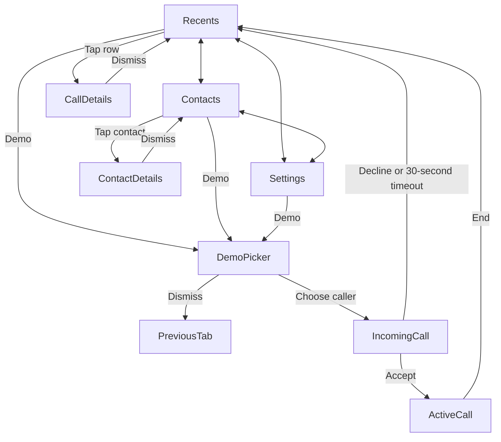

# Callshield for iPhone

Native SwiftUI implementation of the `azim` branch’s Callshield frontend, with separate demo and production interfaces. Build with **Xcode 26 or later** (LiveCommunicationKit requires the iOS 26 SDK); deployment supports **iOS 16 or later**. There are no package dependencies or model downloads.

## Switch demo / production

Open `Callshield.xcodeproj` → **Callshield target → Build Settings → User-Defined → `CALLSHIELD_DEMO`**. Set **`true`** for the existing TSX demo, **`false`** for the production phone interface, then rebuild. Set both Debug and Release if you want both configurations to use the same mode. The checked-in default is `true`. The value is expanded into Info.plist and read by `App/AppConfiguration.swift`.

The two modes own different stores. Production never reads the demo’s fictional contacts/history, simulated timers or results. Debug-only UI test arguments select a mode and isolate production persistence; Release ignores these arguments.

## Run

1. Open `Callshield.xcodeproj` from this folder.
2. Select the **Callshield** scheme and an iPhone simulator, then Run.
3. Tap **Demo**, choose Human voice, AI voice, or Uncertain voice, and accept or decline the incoming call.
4. On a physical iPhone, select your development team in Signing & Capabilities before running.

**In demo mode**, calls and voice assessments are simulated, exactly as in the supplied TSX. No real call is placed or received, and no microphone, address book, network, or classification service is accessed. Mute and speaker change demo state. The source's history and preferences reset when the app process restarts. This is a complete native implementation of the interactive frontend, not a live telephony or voice-detection product.

## Source inventory and implementation map

Reference: `azim` commit `74d8462` (the branch head fetched on October 7, 2026). All eight TSX files were inspected, along with both CSS files, the README flowchart, HTML entry point, and build configuration.

| TSX source | Native implementation | Behavior |
| --- | --- | --- |
| `RecentsScreen.tsx` | `Views/RecentsScreen.swift` | All/Missed, case-insensitive search by name/number/voice label, clear search, empty state, row details |
| `ContactsScreen.tsx` | `Views/ContactsScreen.swift` | Three fictional contacts; contact details; incoming only |
| `SettingsScreen.tsx` | `Views/SettingsScreen.swift` | Larger text, connection/mode information, all voice explanations |
| `CallScreen.tsx` | `Views/CallScreen.swift` | Separate ringing and connected states, accept/decline, elapsed time, assessment, mute/speaker, end |
| `DetailDialog.tsx` | `Views/DetailSheet.swift` | Demo Picker, Call Details, Contact Details; Done, swipe/backdrop dismissal, keyboard Escape |
| `App.tsx` | `App/CallshieldApp.swift`, `Views/CallshieldRootView.swift`, `Core/CallshieldStore.swift` | Shared state, tabs, one modal at a time, timers, notices |
| `shared.tsx` | `Core/CallModels.swift`, `Views/DesignSystem.swift` | Exact five sample identities, seven initial history entries, voice labels, durations, avatars |
| `main.tsx` | `App/CallshieldApp.swift` | Native application entry point |
| `phone.css`, `index.css` | SwiftUI views and `Views/DesignSystem.swift` | Colors, typography, spacing, badges, dividers, avatars, call gradient |

The source includes no photos, audio, fonts, raster images, or separate flowchart image. Its assets are Lucide line icons, text initials, CSS shapes, and CSS gradients. The flowchart is Mermaid in `frontendscreens/README.md`. The native app uses SF Symbols for the corresponding icon roles, system San Francisco typography, SwiftUI shapes, and an original shield/check app icon matching the brand colors. The icon's drawing source is `scripts/draw_icon.swift`.

## Navigation and call lifecycle



- Ringing never shows or performs analysis. Decline/timeout records a missed call with Unknown voice and zero duration.
- Acceptance resets the elapsed clock and shows Analyzing voice. The caller's simulated result appears after **2.6 seconds**.
- Ending saves the accepted call's duration and result. Ending before the assessment completes saves Unknown.
- Call completion inserts one new entry at the top of history, returns to Recents, and shows a **3.5-second** notice. Current filter/search remain intact, matching the TSX.
- Mute/speaker reset at the next call. An active call cannot be replaced by another demo.
- The store derives time from the active call's start date. It reconciles after foregrounding; an expired incoming call cannot be accepted. There is no delayed analysis callback that can affect a subsequent call.

## Native visual adaptations

The phone UI follows the source's mobile CSS breakpoint: 23-point content margins, 36-point screen headings, 43-point avatars, green accents, missed-call red, colored voice pills, and the dark green call gradient. Desktop marketing copy and the decorative browser phone bezel sit outside the app in the TSX and are omitted from the native phone screen. iOS provides the actual status bar, island and home indicator.

Details use a native scrollable sheet with the source's Done button and content. SF Symbols approximate the Lucide icons; native glyph shapes and system sheet geometry differ from the browser. The layout uses safe areas, scrolling, larger-text row sizing, scaled row text/badges and VoiceOver labels. Long rows can stack their subtitle to avoid horizontal clipping. The app keeps the source's light appearance; calls use a dark appearance so the system status bar stays legible.

## Verification

Run Product → Test in Xcode, or from the repository root:

```sh
xcodebuild -project ios/Callshield.xcodeproj -scheme Callshield \
  -destination 'platform=iOS Simulator,name=iPhone 17 Pro' \
  -derivedDataPath /tmp/callshield-native-build \
  -parallel-testing-enabled NO CODE_SIGNING_ALLOWED=NO test
```

`CallshieldTests` covers exact sample data, search/filter combinations, acceptance-only analysis, timing boundaries, all three assessments, early ending, decline/timeout, foreground reconciliation, stale-session isolation, controls/reset, duplicate actions, notices, and duration formatting. `CallshieldUITests` exercises every screen, all caller choices, sheet return paths, search, larger text, call controls, history insertion, decline and the actual 30-second timeout. Named screenshot attachments are retained in the test result bundle.

See `CALLSHIELD_VALIDATION.md` for the observed results and review images. Tests validate demo behavior, not real voice analysis, scam accuracy, or physical-device calling.

The checked-in project can be regenerated after adding Swift sources:

```sh
python3 ios/scripts/generate_callshield_project.py
```

The generator restores its default build settings, including demo mode. Preserve any custom signing/mode settings in the generator before regenerating the project.

## Production phone interface

Production has **Favorites, Recents, Contacts, Keypad and Settings**, contact/call details, and voicemail. It retains the TSX’s colors, avatars, pills and dark green call screen while adding everyday phone navigation.

- Contacts are requested only after **Allow Contacts**, support iOS 18 limited access, refresh after permission/address-book changes, and are searched by name/number. Revoking access clears the contact list.
- Favorites, local call history and Larger text persist in a separate protected JSON file in Application Support. This file is excluded from backup. Saved-data errors are surfaced; corrupt files are not overwritten. Up to 1,000 call records are retained. Deleting a recent hides it in Callshield, including after a system-history refresh; it does not delete Apple’s system history.
- The keypad accepts pasted/typed numbers, digits, `*`, `#`, an international prefix, and deletion. Telephone links and `INStartCallIntent` **prefill** the keypad. Only an explicit **Call** tap dials; external input is validated before routing.
- With no calling backend, physical-device calls are handed to the mobile service through `telephony:` on iOS 18.2+ (`tel:` on older iOS). The simulator displays a clear error. Handoff never creates a fabricated connected session or duration. Without the entitled history API, the app cannot import the existing Apple Phone history.
- With a configured VoIP backend, CallKit handles incoming/outgoing, answer/end, mute, hold, DTMF and audio activation. Speaker routing uses AVAudioSession. The connected clock and assessment wait for actual backend events. Stale call IDs and unfinished analyses cannot affect a subsequent call.
- Voicemail retrieval, read status, deletion and HTTPS audio playback are wired to a separate service contract. Until it is connected, the screen says **Voicemail unavailable**.

### Backend connection points

Implement `Production/BackendContracts.swift` and replace the factories in `AppServices`. Injecting services into `ProductionStore` is also supported for tests and integration.

`CallingBackend` owns authenticated signaling and real media transport. `start` returns when signaling is accepted; `answer` must await incoming-session readiness, coordinating with `prepareIncoming` if necessary. Emit `connected` only for a real connection; emit assessment events only for the same call’s remote audio stream. Start/stop audio through CallKit’s `activateAudio`/`deactivateAudio`, and make `end`/`reset` cancel pending work. No provider SDK, credentials, signup, server, APNs sender, codec, voice model or simulated implementation is included.

`PhoneCallCoordinator` registers PushKit only when the backend is configured. The APNs **VoIP** payload contract is `callUUID` (UUID string), `handle` (phone number), and optional `callerName`. Every VoIP push is reported to CallKit **before** backend preparation, including invalid payloads which are immediately ended; the completion handler runs once. Upload/invalidate the VoIP device token through `registerVoIPToken`. Authenticate incoming sessions server-side rather than trusting a displayed name. Push delivery, lock-screen answering, interruption recovery, transport cancellation, and audio routes need end-to-end device validation with the chosen service.

`VoicemailBackend` supplies ordered messages, confirms mark-read/delete operations, and supplies short-lived authenticated HTTPS audio URLs for AVPlayer. Revisit the privacy manifest and permission wording when adding actual network data collection, analytics or third-party SDKs.

### iPhone default-app capabilities

There are two different Apple roles. Merely switching `CALLSHIELD_DEMO` to false does not grant either entitlement or make this distributable as a complete Phone replacement.

| Role | Setup | Behavior / limits |
| --- | --- | --- |
| Ordinary dialer | Leave `CALLSHIELD_DEFAULT_DIALER=false` and `CALLSHIELD_ENTITLEMENTS_FILE` empty | Production UI can hand calls to the system. Cellular in-call UI, ringing and media remain system-owned. |
| Default **calling** app | iOS 18.2+, real VoIP service; set `CALLSHIELD_ENTITLEMENTS_FILE=Configuration/DefaultCalling.entitlements`; enable approved Calling App/Push Notifications capabilities in your provisioning | CallKit/PushKit VoIP with incoming/outgoing media from your provider. User chooses the app in iPhone Default Apps settings. The entitlement is `com.apple.developer.calling-app`. |
| Default cellular **dialer** | iOS 26+, approved `com.apple.developer.dialing-app`; set `CALLSHIELD_ENTITLEMENTS_FILE=Configuration/DefaultDialer.entitlements` and `CALLSHIELD_DEFAULT_DIALER=true` | Uses LiveCommunicationKit’s `TelephonyConversationManager` and `ConversationHistoryManager`. History begins when configured as default; it is not an unrestricted history import. Apple currently requires an EU-registered developer account and an EU-located test device. |
| VoIP without default-app role | Real VoIP service; set `CALLSHIELD_ENTITLEMENTS_FILE=Configuration/VoIP.entitlements` | Incoming PushKit calls and CallKit UI without the default-calling entitlement. |

Select your development team and a unique bundle identifier. Enable Push Notifications and the existing Audio/VoIP background modes for a real VoIP integration; `APS_ENVIRONMENT=development` for development provisioning and `production` for distribution. If shipping both default roles, combine the granted entitlements in your provisioning and entitlements file. Entitlement templates are opt-in so ordinary demo/production simulator builds do not require restricted capabilities.

The cellular dialer APIs initiate calls and expose permitted history; they do **not** supply cellular call audio to this app or replace all Apple Phone features. Native cellular call control/ringing remain system-owned. Real voice assessments require media supplied by the VoIP service or a separately authorized integration; the current production UI never labels cellular audio using the demo model. Carrier voicemail, emergency/carrier routing, account provisioning, App Store eligibility and distribution signing remain service/platform work.

Official references: [default calling app](https://developer.apple.com/documentation/callkit/preparing-your-app-to-be-the-default-calling-app), [default dialer app](https://developer.apple.com/documentation/livecommunicationkit/preparing-your-app-to-be-the-default-dialer-app), [responding to VoIP pushes](https://developer.apple.com/documentation/pushkit/responding-to-voip-notifications-from-pushkit).
