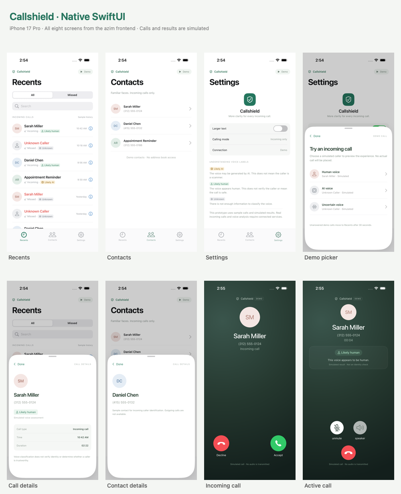
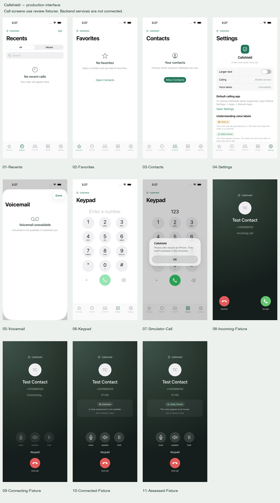

# Native Callshield validation

Validated October 7, 2026, against `azim` commit `74d8462ddc491f8617968dca85b31a0e6016b3e8`.

## Environment and results

- Xcode 26.6, iPhone 17 Pro simulator, iOS 26.5.
- **31 state/model tests passed** (14 demo, 17 production), with zero failures.
- **7 interface tests passed** (5 demo, 2 production), with zero failures. These use real demo timings, including the full 30-second unanswered call.
- **Generic iOS device build passed**, with signing disabled. Physical-device execution and distribution signing were not tested.
- Demo mode needs no service credentials or microphone permission. Production requests contacts only on explicit opt-in, and a configured VoIP service requests microphone permission when calling/answering.

Tests check all eight distinct screens, exact fictional data, filters/search, detail dismissal, Larger text, all three demo caller outcomes, acceptance-only assessment, timing boundaries, completed/missed history, mute/speaker, resets, stale-session isolation, foreground deadline reconciliation and notices.

## Visual review

The original React frontend was rendered locally at a 402 × 874 mobile viewport. Its installed dependency versions required `npm install --legacy-peer-deps --ignore-scripts --package-lock=false` because the supplied esbuild version conflicts with Vite's optional peer dependency. The TSX and configuration files were preserved.

The native screenshot attachments cover every screen and the three voice outcomes. The review checked colors, typography, avatars, rows, badges, search, call controls, detail content, settings and modal layout. The toolbar was adjusted to the source's 26-point visual height while retaining a 44-point Demo touch target. Native status/safe areas, SF Symbol glyphs and the native sheet presentation are intentional visual differences described in `CALLSHIELD.md`; this is a close native adaptation, not a pixel-identical browser rendering.

| State | Screenshot |
| --- | --- |
| Recents | [01-Recents](Review/01-Recents.png) |
| Call Details | [02-Call-Details](Review/02-Call-Details.png) |
| Contacts | [03-Contacts](Review/03-Contacts.png) |
| Contact Details | [04-Contact-Details](Review/04-Contact-Details.png) |
| Settings | [05-Settings](Review/05-Settings.png) |
| Demo Picker | [06-Demo-Picker](Review/06-Demo-Picker.png) |
| Larger text | [07-Recents-Larger-Text](Review/07-Recents-Larger-Text.png) |
| Empty search | [08-Empty-Search](Review/08-Empty-Search.png) |
| Incoming Call | [09-Incoming-Call](Review/09-Incoming-Call.png) |
| Analyzing | [10-Analyzing-Call](Review/10-Analyzing-Call.png) |
| Active Call: human, mute/speaker enabled | [11-Active-Human-Call](Review/11-Active-Human-Call.png) |
| Active Call: AI | [12-Active-AI-Call](Review/12-Active-AI-Call.png) |
| Active Call: uncertain | [13-Active-Uncertain-Call](Review/13-Active-Uncertain-Call.png) |

The shared scheme includes both suites. Screenshots are generated by `CallshieldUITests` and retained in its result bundle. The final test run used `/tmp/callshield-final-tests.xcresult`; the final device build used `/tmp/callshield-device-build`. Both are temporary, local verification artifacts rather than repository dependencies.

## Functional boundary

Demo mode implements the supplied frontend’s simulated behavior. Production mode uses separate persistence and real-service adapters; the backend factories intentionally return unavailable providers until the planned integration. The production UI is implemented, but that is not a claim of shipping readiness, voice-model accuracy, or a universally permitted cellular Phone replacement. See `CALLSHIELD.md` for the platform roles and setup.

## Demo / production split validation

The production test suite covers strict telephone-number/link validation, explicit-only system dialing, no fabricated history after handoff/failure, contacts permission/limited access/revocation, search, persisted favorites/preferences, history merge/deduplication, deletion after refresh/relaunch, corrupt-file protection, save errors, local-file roundtrip and retention bounds. It also checks connected-only timing/assessment, stale events, duplicate connection notifications, unfinished assessments, and voicemail operations confirmed by a mock backend. The first run exposed an unwanted save while loading preferences; initialization now suppresses persistence until loading finishes.

Production interface tests navigate all five tabs and voicemail, confirm the absence of the demo controls and fictional contacts, enter/delete keypad digits, and verify the simulator call error creates no history. Debug tests select their mode explicitly and use an isolated in-memory production repository; the run with `CALLSHIELD_DEMO=false` verifies both suites still work independently.

The production device **Release** build also passes with `CALLSHIELD_DEMO=false` and `CALLSHIELD_DEFAULT_DIALER=true`, compiling the device-only LiveCommunicationKit call path. Plist/entitlement templates were parsed successfully. This is an **unsigned build**, not a provisioned default-dialer test.

The Release simulator was launched with `CALLSHIELD_DEMO=false` and the demo-test argument; it displayed the production interface, confirming Release ignores test overrides. Flipping the same setting to `true` restores the source demo after rebuilding.

Screens 01–07 are screenshots from production interface tests. Screens 08–11 use an isolated native view-hosting test to render **review fixtures** for incoming, connecting, connected/Unknown and assessed calls. They are not evidence of a real incoming call, live transport, or actual model classification. Each named image is saved in `Review/` alongside the original demo review.

The final verification used `/tmp/callshield-mode-final-tests.xcresult` (full suites), `/tmp/callshield-mode-complete.xcresult` (final production/model checks and render fixtures), and `/tmp/callshield-mode-device` (Release device build). The demo views/state were unchanged after the full-suite pass.

Real-device calling, PushKit delivery/token registration, lock-screen answer/end, audio transport/routes, provider voicemail playback, voice-model performance, EU dialer entitlements and App Store signing remain unverified until the backend and provisioning are supplied. No real phone call or server request was made during validation.
