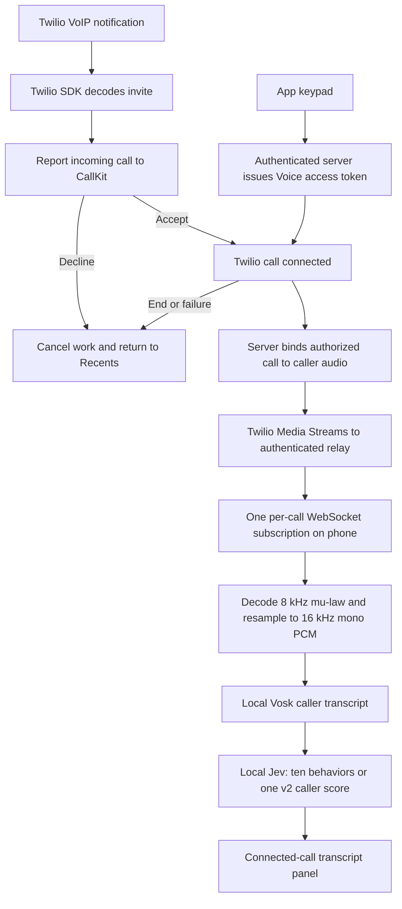

# Pipeline 2: Call Shield transcript protection

The app side is implemented. Call Shield includes Twilio Voice SDK 6.13.7, CallKit/PushKit call controls, an authenticated caller-audio subscription, Vosk speech recognition and Jev inference on the device, plus a Debug-only recording/import screen for testing without live calls. The default build opens the production interface; the original simulated screen demo remains available in Debug with `CALLSHIELD_DEMO=true`. Release always uses the real calling interface and excludes the test screen, test audio source and typed-test entry point. Live Twilio transcription and in-call results remain enabled.

This is integration readiness, not proof of live Twilio calling or scam detection accuracy. The remaining connection is Shrey's authenticated calling server and Twilio provisioning, followed by a physical-iPhone test.

## Try it now without Twilio (Debug only)

1. Open `ios/Callshield.xcodeproj`, select Callshield, and run the Debug configuration on an iPhone simulator.
2. Open Settings → **Test transcript pipeline**.
3. Use **Import audio** to choose a short WAV/M4A recording of your own voice. You can also record through the simulator's microphone, if its Mac audio input is available. Physical microphone recording has not been verified on an iPhone here.
4. Settings also has a **Live transcript model** selector for real calls; the test screen has its own selector. Jev behaviors displays all ten text outputs; Jev v2 caller is the separately trained, single-output caller-text classifier. Rules is the explainable baseline.
5. **Use test script → Check text** tests local inference without speech recognition. It is explicitly a test and creates no call history.

Imported audio is limited to five minutes. Audio and transcript windows are kept in memory, not stored by the analysis pipeline. Call history stores call metadata, not transcripts. The relay is audio transport only; it never runs Jev.

A fresh clone needs the existing Vosk and ONNX assets:

```sh
python3 ios/scripts/setup_vosk.py
python3 ios/scripts/setup_jev.py
python3 ios/scripts/setup_posttrained_jev.py
python3 ios/scripts/generate_callshield_project.py
```

The post-trained assets require access to their existing private release. The app bundles original Jev and v2, about 1.2 GB together, plus the Vosk model. Only one Jev variant is loaded at a time. This footprint should be reduced before distribution; iPhone memory, battery, heat and real-call latency remain unmeasured.

## Flow

The accessible library implementation guide and `origin/azim:frontendscreens/README.md` specify acceptance/connection before analysis, and cancellation on call end. The new pipeline follows that lifecycle:



The voice AI/human label belongs to pipeline 1. Transcript results never populate that label. A human voice can still be a scam; Jev takes text and does not classify synthetic voices.

## Server contract for Shrey

Configure these endpoints on your existing authenticated calling server. The app's **Settings → Calling connection** accepts its HTTPS base URL and a **server-issued user session token**, stored in Keychain. It activates the SDK adapter immediately. Do not put a Twilio Auth Token or API Key Secret in the app. Redirects are rejected.

### POST /voice/token

Header: `Authorization: Bearer <user session token>`

Body: `{}`

Response:

```json
{"token":"<short-lived Twilio Voice access token>","identity":"<authenticated user identity>"}
```

Authenticate the user and derive the identity on the server. Grant outgoing calls through your TwiML App SID and incoming calls with the matching APNs VoIP push credential. The app registers/unregisters PushKit tokens with Twilio's SDK. Outgoing SDK connect parameters contain **`To`**, capital T; your TwiML handler must use that exact parameter, validate permitted destinations, and dial the number. Incoming TwiML must dial the authenticated Client identity.

### POST /voice/analysis

Same user Authorization header.

Body example:

```json
{"call_sid":"CA_sdk_call","call_uuid":"<CallKit UUID>","direction":"incoming"}
```

Response:

```json
{
  "audio_url":"wss://your-relay/audio/<session_id>",
  "bearer_token":"<single-session relay subscriber token>",
  "caller_track":"inbound",
  "call_sid":"CA_actual_streamed_leg"
}
```

Verify through Twilio that the requested SDK call belongs to this authenticated user. Resolve the actual leg and **track carrying the remote caller**; `inbound` and `outbound` are relative to Twilio's call leg, not to whether the app user placed the call. If you stream the PSTN caller leg, inbound generally contains that caller; if you stream the app's Client leg, its inbound track contains the app user's microphone and outbound generally contains the remote party. Verify this with distinct sentences from each participant. Never mix both tracks into Jev v2.

Create a subscription using the included relay's `POST /sessions` server-to-server API with `call_sid` and `caller_track`. Return its audio URL and per-call token to the app. Start a **unidirectional** Media Stream on that same leg (Streams REST API or `<Start><Stream>`), selecting `inbound_track`, `outbound_track`, or `both_tracks` as appropriate. Use the returned `twilio_stream_url`. Continue your TwiML call routing after `<Start>`; it does not carry the conversation by itself. The relay waits up to 15 seconds for the phone to subscribe and forwards only the configured caller track.

Use a public TLS endpoint reachable by Twilio. Provision VoIP/background capabilities and APNs signing on the physical phone using `ios/Configuration/VoIP.entitlements`; incoming calls need a compatible push credential matching the app's provisioning environment. Default-dialer entitlement is optional and grants no access to Phone.app's audio. Existing ordinary cellular-call handoff remains available when the calling server is disconnected, with no analysis claimed for those calls.

## Included audio relay

See `backend/transcript-relay/README.md`. It validates Twilio's handshake signature, scopes phone tokens to one call, checks the streamed Call SID/Stream SID, rejects duplicate subscribers, filters the selected caller track, and closes both sides on teardown. It has bounded messages and subscriptions, five-minute setup expiry and a one-hour connected-session cap. It uses a single process with in-memory state; multi-worker hosting needs shared coordination or sticky routing.

An alternative app-owned media provider can emit `CallingEvent.callerAudio(callID, ownedRemotePCMBuffer)` after `.connected`. The Twilio adapter uses `callerStream`, so these are alternative inputs. Never feed both for the same session.

## What was verified on October 14, 2026

41 distinct native unit/integration tests, 8 UI tests and 3 relay tests passed across full and targeted runs; the unsigned Release iPhone build passed. See `CALLSHIELD_VALIDATION.md` for screenshots and verification boundaries.

- Real synthetic speech WAV → Vosk → ten local Jev outputs in Call Shield.
- The same speech converted to telephone 8 kHz mu-law → Twilio frame decoder → 16 kHz PCM → Vosk → Jev.
- Signed simulated Twilio WebSocket → authenticated local relay → native simulator WebSocket → Vosk → ten Jev outputs.
- Caller-track filtering, call/stream identity checks, duplicate frames, missing chunks, bad payloads, old sessions and old model results.
- Jev v2 loading, Rules comparison, model switching and native transcript-screen navigation.
- Server request shapes, session authorization and explicit rejection of malformed responses.

The narrowband fixture misheard “verification” as “very sad case and”; upsampling preserves input compatibility but cannot restore lost speech detail. These fixtures validate plumbing, not recognition accuracy or scam-model quality. Original Jev remains an experimental behavior estimator; v2's calibration uses synthetic calls. Physical-iPhone calls, Bluetooth routes, APNs delivery, live Twilio transport, and detection quality need end-to-end testing after Shrey connects his server.

## iOS audio access

Apple states that only the app carrying a call has access to its audio: [Apple DTS answer](https://developer.apple.com/forums/thread/835552). There is no supported experimental switch for intercepting ordinary cellular-call audio. A Bluetooth accessory does not grant a third-party iOS app that access; external recording hardware would be a separate system requiring its own engineering and validation.

Twilio supports app-owned custom audio devices: [official SDK example](https://github.com/twilio/voice-quickstart-ios/blob/master/Docs/new-features-3.0.md). This implementation instead uses its supported [Media Streams protocol](https://www.twilio.com/docs/voice/media-streams/websocket-messages) through the relay. Jev stays on the phone in either design.
