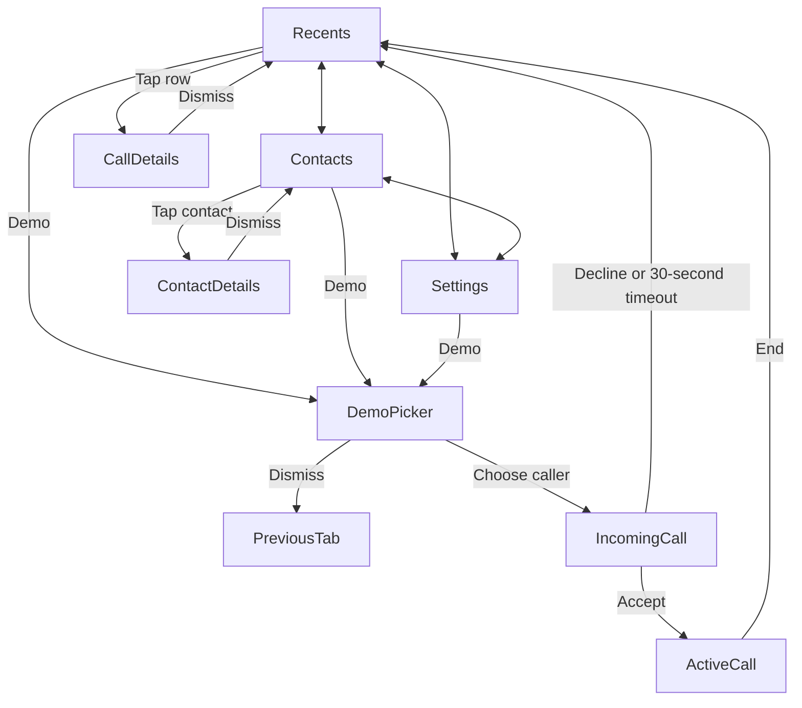

# Callshield for iPhone

Native SwiftUI implementation of the `azim` branch's Callshield frontend. All eight screens and all interactive demo behavior are implemented. Requires Xcode 14 or later and iOS 16 or later. There are no package dependencies or model downloads.

## Run

1. Open `Callshield.xcodeproj` from this folder.
2. Select the **Callshield** scheme and an iPhone simulator, then Run.
3. Tap **Demo**, choose Human voice, AI voice, or Uncertain voice, and accept or decline the incoming call.
4. On a physical iPhone, select your development team in Signing & Capabilities before running.

Calls and voice assessments are simulated, exactly as in the supplied TSX. No real call is placed or received, and no microphone, address book, network, or classification service is accessed. Mute and speaker change demo state. The source's history and preferences reset when the app process restarts. This is a complete native implementation of the interactive frontend, not a live telephony or voice-detection product.

## Source inventory and implementation map

Reference: `azim` commit `74d8462` (the branch head fetched on October 7, 2026). All eight TSX files were inspected, along with both CSS files, the README flowchart, HTML entry point, and build configuration.

| TSX source | Native implementation | Behavior |
| --- | --- | --- |
| `RecentsScreen.tsx` | `Views/RecentsScreen.swift` | All/Missed, case-insensitive search by name/number/voice label, clear search, empty state, row details |
| `ContactsScreen.tsx` | `Views/ContactsScreen.swift` | Three fictional contacts; contact details; incoming only |
| `SettingsScreen.tsx` | `Views/SettingsScreen.swift` | Larger text, connection/mode information, all voice explanations |
| `CallScreen.tsx` | `Views/CallScreen.swift` | Separate ringing and connected states, accept/decline, elapsed time, assessment, mute/speaker, end |
| `DetailDialog.tsx` | `Views/DetailSheet.swift` | Demo Picker, Call Details, Contact Details; Done, swipe/backdrop dismissal, keyboard Escape |
| `App.tsx` | `App/CallshieldApp.swift`, `Views/CallshieldRootView.swift`, `Core/CallshieldStore.swift` | Shared state, tabs, one modal at a time, timers, notices |
| `shared.tsx` | `Core/CallModels.swift`, `Views/DesignSystem.swift` | Exact five sample identities, seven initial history entries, voice labels, durations, avatars |
| `main.tsx` | `App/CallshieldApp.swift` | Native application entry point |
| `phone.css`, `index.css` | SwiftUI views and `Views/DesignSystem.swift` | Colors, typography, spacing, badges, dividers, avatars, call gradient |

The source includes no photos, audio, fonts, raster images, or separate flowchart image. Its assets are Lucide line icons, text initials, CSS shapes, and CSS gradients. The flowchart is Mermaid in `frontendscreens/README.md`. The native app uses SF Symbols for the corresponding icon roles, system San Francisco typography, SwiftUI shapes, and an original shield/check app icon matching the brand colors. The icon's drawing source is `scripts/draw_icon.swift`.

## Navigation and call lifecycle



- Ringing never shows or performs analysis. Decline/timeout records a missed call with Unknown voice and zero duration.
- Acceptance resets the elapsed clock and shows Analyzing voice. The caller's simulated result appears after **2.6 seconds**.
- Ending saves the accepted call's duration and result. Ending before the assessment completes saves Unknown.
- Call completion inserts one new entry at the top of history, returns to Recents, and shows a **3.5-second** notice. Current filter/search remain intact, matching the TSX.
- Mute/speaker reset at the next call. An active call cannot be replaced by another demo.
- The store derives time from the active call's start date. It reconciles after foregrounding; an expired incoming call cannot be accepted. There is no delayed analysis callback that can affect a subsequent call.

## Native visual adaptations

The phone UI follows the source's mobile CSS breakpoint: 23-point content margins, 36-point screen headings, 43-point avatars, green accents, missed-call red, colored voice pills, and the dark green call gradient. Desktop marketing copy and the decorative browser phone bezel sit outside the app in the TSX and are omitted from the native phone screen. iOS provides the actual status bar, island and home indicator.

Details use a native scrollable sheet with the source's Done button and content. SF Symbols approximate the Lucide icons; native glyph shapes and system sheet geometry differ from the browser. The layout uses safe areas, scrolling, larger-text row sizing, scaled row text/badges and VoiceOver labels. Long rows can stack their subtitle to avoid horizontal clipping. The app keeps the source's light appearance; calls use a dark appearance so the system status bar stays legible.

## Verification

Run Product → Test in Xcode, or from the repository root:

```sh
xcodebuild -project ios/Callshield.xcodeproj -scheme Callshield \
  -destination 'platform=iOS Simulator,name=iPhone 17 Pro' \
  -derivedDataPath /tmp/callshield-native-build \
  -parallel-testing-enabled NO CODE_SIGNING_ALLOWED=NO test
```

`CallshieldTests` covers exact sample data, search/filter combinations, acceptance-only analysis, timing boundaries, all three assessments, early ending, decline/timeout, foreground reconciliation, stale-session isolation, controls/reset, duplicate actions, notices, and duration formatting. `CallshieldUITests` exercises every screen, all caller choices, sheet return paths, search, larger text, call controls, history insertion, decline and the actual 30-second timeout. Named screenshot attachments are retained in the test result bundle.

See `VALIDATION.md` for the observed results and review images. Tests validate demo behavior, not real voice analysis, scam accuracy, or physical-device calling.

The checked-in project can be regenerated after adding Swift sources:

```sh
python3 ios/scripts/generate_project.py
```
