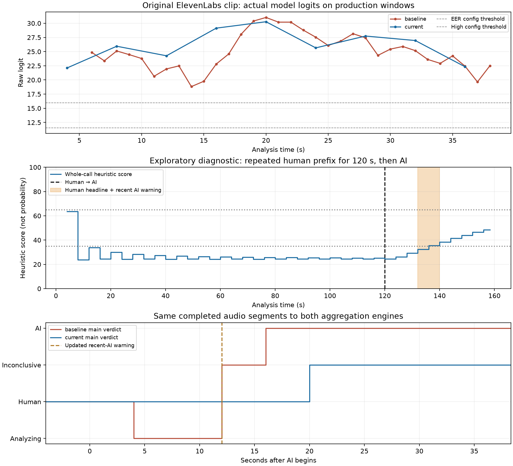

# Trent: real-model before/after evaluation

**Conclusion: mixed.** The cumulative update reduces false AI headlines on these two human controls and retains evidence across silence, but it loses AI detections on the quiet and noisier copies and responds more slowly to changes in speech. Actual model outputs reproduce a Human headline alongside an active recent-AI warning. This is a small, related-audio case study, not a general accuracy benchmark.

Run date: October 22, 2026 (America/Chicago). All supplied audio stayed local. No production detection logic, weights, thresholds, branches, or deployments were changed.

## Exact comparison and runtime

- Before: `dca989c3126be4778638a002d3355a463f8789eb`.
- After/current remote `shrey`: `ec2f4dd80de433f176b1d9f90a20ca35d60707aa` (checked through GitHub API during this run).
- Cumulative feature introduced in `c182ddaa5e07f1a582b8ee883642a01d0bf9e461`. Subsequent changes merge recording-disclosure gating and add iOS deadline/simulator tests; core scoring/model files did not change after the feature.
- Source snapshots: 87 files verified against exact remote Git blob IDs; see [source audit](source_audit.md), [manifest](source_manifest.json), and saved comparisons/patches. Working checkout stayed `improved-ui` at `0fe9400e702abb62a2e7e9df5bd6dfd5a3cdef51`, initially clean, with no remote configured.
- Model implementation, detector configuration, adapter, per-window normalization and neural thresholds are byte-identical between revisions. Full production windowing **and** aggregation changed. Baseline drops low-RMS frames and repeatedly scores overlapping voiced audio; updated code retains contiguous pauses, requires distinct four-second windows with >=1.5 s above RMS .01, rejects >5% near-full-scale clipping, and weights by speech fraction.
- Checkpoint: `/Users/spatel7/Downloads/best.pt`; SHA-256 `ae78eb6ed8e343dedd72351d942a27718eced82f355a90ef7583334a203beec0` verified before every load; strict state-dict loading succeeds. No random weights or injected scores are used in the real-audio results.
- Original architecture: `facebook/wav2vec2-xls-r-300m`, 12 retained layers, learned layer weighting and attentive statistics pool. Official architecture configuration pinned at `1a640f32ac3e39899438a2931f9924c02f080a54`, saved in `snapshots/architecture/config.json`; local config resolution is the only model-loading harness shim.
- Architecture JSON SHA-256: `0bffa0d0e98153e883b828d86491f3c6062cb563dc9d7a9cfd1790da30c286ac`.
- Thresholds unchanged: EER/elevated `0.9999904632568359`, high `0.9999998807907104`. Metadata names do not establish those error rates on these clips. New heuristic headline cutoffs remain 35/65; no threshold was tuned.
- Existing `.venv` preserved and used: Python **3.14.8**, PyTorch **2.14.1**, Transformers **5.20.2**, NumPy **2.5.4**, SciPy **1.18.1**, SoundFile **0.14.0** / libsndfile **1.2.2**; complete versions in [dependencies.txt](dependencies.txt). `pip check` passes. Compatible cp314 ARM wheels exist, so no alternate environment was needed.
- Device: Apple **MPS**, float32, macOS 26.7.1 ARM64. Sandbox initially hid MPS; the authorized local execution outside the sandbox exposes it. Full model ran without fallback or unsupported-operation errors. CPU/MPS first-four-second logits differed by ~0.000034; this is a spot check, not exhaustive numerical equivalence.

## Audio, conditions, and sample counts

- AI source: user-identified newly generated ElevenLabs scam recording, supplied MP3. SHA-256 `86e4df799bad88b6c3df61bdf459b7bd698345ee78c4989d4a0ac13bf3893198`.
- Actual decoded length: **1,691,136 samples / 44,100 Hz = 38.347755 s**, mono MP3, reported bitrate 128 kb/s. Apple `afinfo` agrees (~38.347750 s). SoundFile `info` gives an inconsistent compressed-header estimate of 39.496939 s; replay uses decoded samples, not that estimate. After polyphase resampling, length is 613,565 samples / 16 kHz = 38.3478125 s. See [audio properties](results/audio_properties.json) and Apple parser log.
- Human controls: two **40.000 s**, mono 16 kHz PCM16 LibriSpeech `test-clean` controls, speakers **1320** and **6930** (two male readers). Official [OpenSLR corpus](https://www.openslr.org/12/) identifies human LibriVox audiobook speech. [Provenance, hashes, and source utterances](human_control_provenance.json) and [selection notes](provenance/HUMAN_CONTROLS.md) are saved. Selection preceded inference: first two archive speakers, archive-order utterances concatenated and cropped. Utterance joins, read speech, and unknown model-training overlap limit the control.
- Ten AI-only related conditions: original; 8 kHz sample-rate reduction (~4 kHz low-pass); actual G.711 μ-law encode/decode at 8 kHz via libsndfile; volume ×0.1 (−20 dB); amplification to the absolute-sample 99th percentile then full-scale clipping (~1% samples); white Gaussian noise at 30/20/10 dB whole-recording SNR; and 2/10 s silence inserted after 16 s.
- The **8 kHz sample-rate reduction is not a phone codec**. G.711 includes real μ-law companding, verified against all 256 codewords of the original decoder and encoder golden vectors; it is still not a complete PSTN/network simulation (no packet loss, echo, AGC, 300 Hz high-pass, or deployed telephony path). Noise seed is 20261022; SNR is pre-PCM whole-recording RMS, including pauses. PCM clipping can slightly alter achieved SNR.
- Six related transition constructions: 60 s of speaker 1320 (40 s control plus repeated prefix) → AI; AI → speaker 1320; and four post-hoc diagnostics using speaker 6930: first 16 s → AI; repeated first 16 s extended to60/120 s → AI; AI → full40 s control. These diagnostics deliberately investigate the observed failure mechanism after seeing the controls. They are **not independent validation samples**, speakers, or new deepfakes.
- Total: **18 replay conditions**, derived from **one synthetic recording and two human readers**. **1160 actual production-window forward passes**, 538 distinct float audio inputs, 622 repeated inputs re-inferred; zero inference cache hits. Matched-engine replays intentionally reuse the same completed model outputs to isolate aggregation. Window counts are not independent sample counts.

## Full production replay: AI-only conditions

Times are seconds from start of available caller audio, after disclosure. “Uncertain” is rendered as Inconclusive. A dash means no AI verdict before call end. None of these ten AI-only conditions produced a Human headline in either version.

| Condition | Old first AI | New first AI | Old / new at 15 s | New first recent warning | New final headline / score | Old / new submitted windows |
|---|---:|---:|---|---:|---|---:|
| Original | 8.02 | 8.02 | ai / ai | 12.02 | ai / 96.60 | 33 / 9 |
| 8 kHz sample rate (~4 kHz bandwidth) | 9.02 | 8.02 | ai / ai | 12.02 | ai / 96.40 | 32 / 9 |
| G.711 μ-law, 8 kHz | 9.02 | 8.02 | ai / ai | 12.02 | ai / 91.70 | 32 / 9 |
| Volume −20 dB | 20.02 | — | waiting / uncertain | — | uncertain / — | 16 / 0 |
| Mild clipping (~1% samples) | 7.02 | 8.02 | ai / ai | 12.02 | ai / 96.40 | 34 / 9 |
| White noise, 30 dB SNR | 8.02 | 8.02 | ai / ai | 12.02 | ai / 91.70 | 33 / 9 |
| White noise, 20 dB SNR | 8.02 | 8.02 | ai / ai | 12.02 | ai / 82.20 | 33 / 9 |
| White noise, 10 dB SNR | 18.02 | — | uncertain / uncertain | 28.02 | uncertain / 63.30 | 36 / 9 |
| 2 s pause at 16 s | 8.02 | 8.02 | ai / ai | 12.02 | ai / 96.60 | 33 / 10 |
| 10 s silence at 16 s | 8.02 | 8.02 | ai / ai | 12.02 | ai / 96.60 | 29 / 10 |

- Old eventually reaches AI in all ten related AI-only conditions; new does so in eight. New misses: **−20 dB volume** (zero eligible model submissions) and **10 dB noise** (nine submissions, final Inconclusive 63.3/100, recent warning at28.02 s). These are counts on related variants, not accuracy percentages.
- At 15 s both have AI headlines in eight conditions. Both lack AI at 15 s for low volume and10 dB noise. At low volume, old still waits; new display deadline yields Inconclusive while backend remains Analyzing. Its gate requires >=1.5 s loud-enough frames inside each contiguous 4 s window; the old gate can collect 3 s voiced material over a much longer interval.
- New is about 1 s earlier for bandwidth/G.711, essentially tied on original and the two easier noise levels, and about 1 s slower on mild clipping. The original model decision itself did not change; different submitted windows and aggregation cause these behaviors.
- With 10 s inserted silence, old clears its evidence/verdict after 6 s without speech; new retains AI and accumulated evidence. That is a real-audio evidence-retention improvement, not fresh evidence about silent audio.

## Identical segments: aggregation isolated

Both engines receive exactly the updated session’s completed eligible windows, raw logits, probabilities, speech weights and measured completion times. Baseline uses its original EMA; it has no weight argument. Its session windowing and silence-reset policy are intentionally outside this isolation experiment.

| Condition | Old first AI | New first AI | Interpretation |
|---|---:|---:|---|
| Original | 12.02 | 8.02 | AI at two segments versus three |
| White noise, 10 dB SNR | — | — | Neither reaches AI |
| diagnostic_human_prefix60_then_ai | 76.02 | — | Whole-call history slows the updated headline |
| diagnostic_human_prefix120_then_ai | 136.02 | — | Whole-call history slows the updated headline |

Thus the 10 dB production difference cannot be attributed solely to aggregation: **both aggregators fail to reach AI on the same new contiguous windows**. The old production path gets different pause-stripped/overlapping inputs. On clean original segments the new aggregator is faster, while its long-history transition behavior is worse.

## Verified human controls (not a population false-positive estimate)

| Human control | Old first false AI | Old AI-headline duration | New first AI / recent warning | Old / new at 15 s | New final state / score |
|---|---:|---:|---|---|---|
| librispeech_test_clean_1320_40s | 6.02 | 8.98 s | — / — | uncertain / uncertain | uncertain / 53.90 |
| librispeech_test_clean_6930_40s | 8.02 | 13.00 s | — / — | uncertain / human | uncertain / 37.20 |

Old produces at least one false AI headline on **2 of 2** human controls; new on **0 of 2**, with no recent-AI warning on either standalone control. New is not consistently confident Human: speaker 1320 remains Inconclusive; speaker 6930 is Human around 8.02–24.02 s and then Inconclusive. On identical segments, old falsely labels speaker 1320 AI for about20 s; new does not, supporting an aggregation benefit for that control. No general false-positive rate, confidence interval, EER, AUC, or calibration claim is justified.

## Changing speech and the known tradeoff

Transition delays below are relative to the labeled speech switch, not first AI anywhere earlier in the call. The old path already falsely warns on several human introductions; those false positives must not count as successful AI detection.

| Human → AI construction | Old AI delay | New warning delay | New leaves Human | New AI delay | New Human during AI | New Human + warning overlap |
|---|---:|---:|---:|---:|---:|---:|
| human60_then_ai | 6.02 | 8.02 | already non-Human | 20.02 | 0.00 s | 0.00 s |
| diagnostic_human16_then_ai | 5.02 | 12.02 | 8.02 | 16.02 | 8.02 s | 0.00 s |
| diagnostic_human_prefix60_then_ai | 5.02 | 12.02 | 12.02 | — | 12.02 s | 0.00 s |
| diagnostic_human_prefix120_then_ai | 1.02 | 12.02 | 20.02 | — | 20.02 s | 8.00 s |

- Recent warning has its own false alerts: in the repeated60 s speaker 1320 human introduction it is active from about48.02–56.02 s (8.00 s) before any AI begins, while the main headline remains Inconclusive. Zero warnings on the two standalone controls therefore does not mean zero warnings on related human-only portions.
- Primary 60 s human1320 introduction: updated is already Inconclusive at the switch; warning arrives8.02 s into AI, AI headline20.02 s into AI. Old AI arrives6.02 s after the switch, with earlier human false alarms. This does **not** demonstrate Human+warning coexistence.
- Targeted 120 s repeated-human-prefix diagnostic **does** reproduce it with real logits: Human persists20.02 s into known AI, warning activates12.02 s into AI, and they coexist for8.00 s. At warning activation the whole-call heuristic is 32.3/100 and the headline is Human; at 20.02 s it becomes Inconclusive 38.5. At call end, after 38.35 s AI, it remains Inconclusive 48.4. Matched old engine leaves Human after4.02 s and reaches AI after16.02 s on exactly the same segments. No injected scores or production threshold edits are involved.
- In the60 s prefix diagnostic, final heuristic65.6 coexists with Inconclusive because headline changes require two qualifying updates; the first score >=65 arrives too late for a second completed segment. A single score crossing does not immediately change the label.
- Reverse AI→human transitions retain an AI headline for all 40 s of subsequent human speech in the updated pipeline; recent warning clears about 17.67 s (speaker 1320) /13.67 s (speaker 6930) after the switch. Old leaves AI at about 12.67 s /13.67 s initially, though it can relapse. These are residual headlines in mixed calls, **not standalone human false positives**. Both are consistent with the new whole-call summary’s strong memory, and problematic if users interpret it as current-speech status.



## Original clip milestones

Old has no comparable 0–100 heuristic score; its aggregate is a raw-logit EMA. Raw per-window model outputs and all other condition milestones are saved as JSON/CSV.

| Time | Old headline | Old EMA logit | New headline | New heuristic score | New recent warning |
|---|---|---:|---|---:|---|
| 5 | waiting | — | analyzing | 91.40 | False |
| 10 | ai | 24.55 | ai | 95.20 | False |
| 15 | ai | 21.01 | ai | 95.20 | True |
| 20 | ai | 27.06 | ai | 96.20 | True |
| 30 | ai | 26.27 | ai | 96.90 | True |
| end | ai | 22.16 | ai | 96.60 | True |

## Computation, replay timing and display limits

- Replay delivers realistic 20 ms int16 frames to each exact production `VoicedWindow`/`AudioScoringSession`. It mirrors the agent’s default next-score deadline (first at 1 s, rescheduled from each eligible poll), allows one inference in flight, and applies its measured duration to a simulated completion event. Generation checks and refresh run at completion. A source-index ring verifies every submitted sample and records disjoint source intervals for old pause-stripped windows.
- Actual offline computation executes faster than call time; no wall-clock sleeps emulate a live phone call. Inference completes at simulated submission + measured computation duration, separately from Python-loop runtime. Pending work at stream end is recorded as uncompleted/canceled and never changes the call-end verdict, matching agent cleanup. Matched replay only uses completed windows.
- App headlines are a Python mirror of the pinned Swift contract (independently checked by Foundation regression tests), not observed rendering. Network, LiveKit transport, app scheduling, reliable publication, audio capture, and recording-disclosure delays are excluded. Baseline has no 15 s display fallback. Updated fallback turns Waiting/Analyzing into Inconclusive at 15 s; it does not guarantee a model classification. For tables, connection and analysis origins are aligned at 0. Real updated calls wait for completed disclosure playback (timeout 15 s) before opening the caller stream and starting analysis, while the app deadline starts on connection, so answer-to-verdict delay is not measured.
- No completed live phone-call, deployed service, simulator end-to-end, or physical-device test is claimed.

| Measured compute | Value |
|---|---:|
| Cold Python imports in probe | 6.949 s |
| First MPS model construction/load | 1.655 s |
| First MPS forward, including cold kernels | 1513.6 ms |
| Subsequent probe forwards | 29.3, 19.6 ms |
| Final run model/adapter startup including zero warmup (already primed process/device caches) | 1.692 s |
| baseline: all submitted real windows median / p95 / max | 19.45 / 20.46 / 69.36 ms |
| current: all submitted real windows median / p95 / max | 20.15 / 20.59 / 21.03 ms |
| Final full offline run wall time, including load/transforms/results | 29.80 s |

Cold and warm numbers come from separate measurements and cache states; they must not be presented as one guaranteed deployment startup budget. GPU `.item()` synchronizes the scalar result before latency is recorded. See [probe JSON](results/model_probe.json), [probe log](logs/model_probe.log), and per-window measurements.

## Regression checks (synthetic, separate from model evidence)

| Check | Outcome |
|---|---|
| Baseline voice integration | 9 passed |
| Updated cumulative scoring | 8 passed |
| Updated voice integration | 9 passed |
| Mocked agent orchestration | Baseline 6 passed / updated 10 passed |
| Updated recording notice | 6 passed |
| Both offline CLI runners | Passed with seeded stub scores; plumbing only |
| Swift Foundation contract | Baseline 8 / updated 11 wire fixtures, malformed/oversize rejection; updated 15-second boundary, late recovery, pause retention, history round-trip passed |
| Full iOS simulator/XCTest | Not run: sandbox simulator probe failed; escalated probe aborted after waiting for approval |

See [regression report](regression_report.md) and its logs for exact commands and passing/failing/blocked checks. Harness checks additionally pass all 256 G.711 decoder codewords, encoder golden vectors, exact sample-interval coverage, completion-latency accounting, no cached production scores, identical matched-engine evidence, and timeline/label bounds. [Snapshot verification](logs/verify_snapshots.txt) passes all 87 files. There were no assertion failures among the completed regression checks. Agent tests use the production LiveKit SDK versions 1.1.20 / agents 1.8.6 / API 1.2.1 with mocked rooms and audio; they place no calls. Initial missing-SDK imports were resolved through installation. These checks establish software behavior, not detector accuracy.

## Failures, limitations and recommendations

1. **Address current-speech communication.** An active recent-AI warning should receive prominent treatment when the whole-call headline remains Human. Keep whole-call history distinct from the current-speaker warning. Validate any change on independent calls, rather than tuning this evaluation’s cutoffs.
2. **Investigate quiet-speech eligibility.** The updated quiet clip never reaches the model. Evaluate a better VAD/level policy with verified low-volume human and AI speech. This task did not alter production gating.
3. **Test phone-domain accuracy independently.** Add more speakers, synthetic systems, real noisy phone recordings, codecs and languages, held out from model training/calibration. These two male audiobook readers and one synthetic voice do not establish broad recall, false-alarm rates, or performance on elderly callers.
4. Whole-call bounded evidence limits outlier influence and avoids overlapping-window overcounting by construction, but this run does not independently establish improved population outlier robustness. Prior injected-score tests remain synthetic evidence only.
5. Setup initially hit sandbox DNS restrictions and unauthenticated plain Git access; authorized package/config/corpus downloads and the connected GitHub API resolved them. Python 3.14 itself was compatible. The compressed-duration discrepancy and preliminary harness limitations were diagnosed and documented, not silently carried into timing.
6. New harness replaces preliminary modulo scheduling with the production next-score rule, records exact intervals/completion/cancellation, and separates app-mapped states from backend state. No production correction was made. The extra prefix diagnostics are labeled post hoc; no threshold selection or probability calibration was performed.

## Reproduce

From the project root (quote the intentionally spelled directory):

```sh
cd /Users/spatel7/Documents/congressional-app-challenge-2026-main
.venv/bin/python -m pip install -r "model teseting/dependencies.txt"
.venv/bin/python -m pip check
.venv/bin/python "model teseting/verify_snapshots.py"
# Needed only if ignored human audio is absent; streams official archive, bounded extraction:
.venv/bin/python "model teseting/fetch_human_controls.py"
# Required supplied files stay at the original Downloads paths; do not add them to Git.
# Model configuration is already pinned locally. Optional first-load CPU/MPS probe:
.venv/bin/python "model teseting/probe_model.py" > "model teseting/logs/model_probe.log" 2>&1
.venv/bin/python "model teseting/evaluate.py" --device mps > "model teseting/logs/evaluation.log" 2>&1
# Use --device cpu if MPS is unavailable; timings will differ.
.venv/bin/python "model teseting/check_harness.py" > "model teseting/logs/harness_checks.json"
.venv/bin/python "model teseting/report.py"
.venv/bin/python "model teseting/fallback_regressions.py"
bash "model teseting/run_swift_checks.sh"
.venv/bin/python "model teseting/run_agent_checks.py"
```

If re-downloading architecture config, official pinned URL: [Facebook Wav2Vec2 config](https://huggingface.co/facebook/wav2vec2-xls-r-300m/resolve/1a640f32ac3e39899438a2931f9924c02f080a54/config.json). Keep `snapshots/architecture/config.json` byte-identical to the recorded hash. `probe_model.py` and `evaluate.py` verify the supplied checkpoint before loading; both use the original model code with strict state-dict loading.

Reproduction requires those private supplied files and a compatible OS/device/runtime. Scores and decision order should reproduce at these locked versions; exact millisecond timing varies by load/caches. Audio generation is seeded; related repetitions reuse source speech but every production window is re-inferred.

## Saved artifacts

- `results/real_audio_results.json`: every production submission’s source intervals, raw logit, returned sigmoid, latency, weight, completion payload, full assessment changes, milestone summaries, and both matched-engine replays.
- `results/per_window.csv`, `results/summary.csv`, `results/milestones.csv`: flattened measurements and comparisons; blank old heuristic scores are intentional.
- `results/score_over_time.png` / `.svg`: explanatory plot; `results/model_probe.json`, `results/audio_properties.json`: runtime and decoding evidence.
- `logs/`: actual inference output, cold/warm probe, architecture revision headers, checks and regression logs. `results/original_first_run.*` preserves the initial repeated execution of the same original clip; its compressed-header duration estimate is superseded by the final decoded-sample metadata.
- `source_manifest.json`, `source_trees.json`, snapshots, patches and connector responses: exact source provenance. `human_control_provenance.json`, corpus docs, downloader and pinned dependencies support reproduction.
- `results/repeatability.json`: original-only rerun and final benchmark have identical input windows and exact logits in both versions; latency varies slightly.
- Local `.gitignore` excludes audio, weights/symlinks, caches, environment directories and Python caches. Nothing was committed.
